# score backend: the whole picture

How score's backend works: what each piece does, how the pieces connect, and where the money goes.

In the diagrams:
- a **dashed** box is a piece we haven't built yet;
- a **thick** arrow is USDC moving;
- a **dotted** arrow is something being checked.

For more detail, see `anchor/README.md`, `engine/README.md` and `backend/README.md`: how to run and test the code.

---

## 1. The idea in one minute

- **The money lives on Solana.** All users' USDC sits in one account that only our program can move, and only by its rules. We call it the *custody account*. No one person's key can take money out of it.
- **The trading happens on our server.** The *engine* keeps the record of who owns what: USDC balances, player tokens, orders and liquidity positions. It fills an order in about 30 microseconds, and trades cost nothing on Solana.
- **The two are tied together.**
  - Deposits and withdrawals are real Solana transactions, signed by the user.
  - Every 10 to 30 seconds, the engine posts a *fingerprint* of its whole record to the program.
  - Each time, the program checks that the custody account still holds enough USDC to cover everything the engine says users own.

The result is as fast as an exchange, while the money stays in an account no single key can drain.

---

## 2. The big picture

### 2.1 The three parts

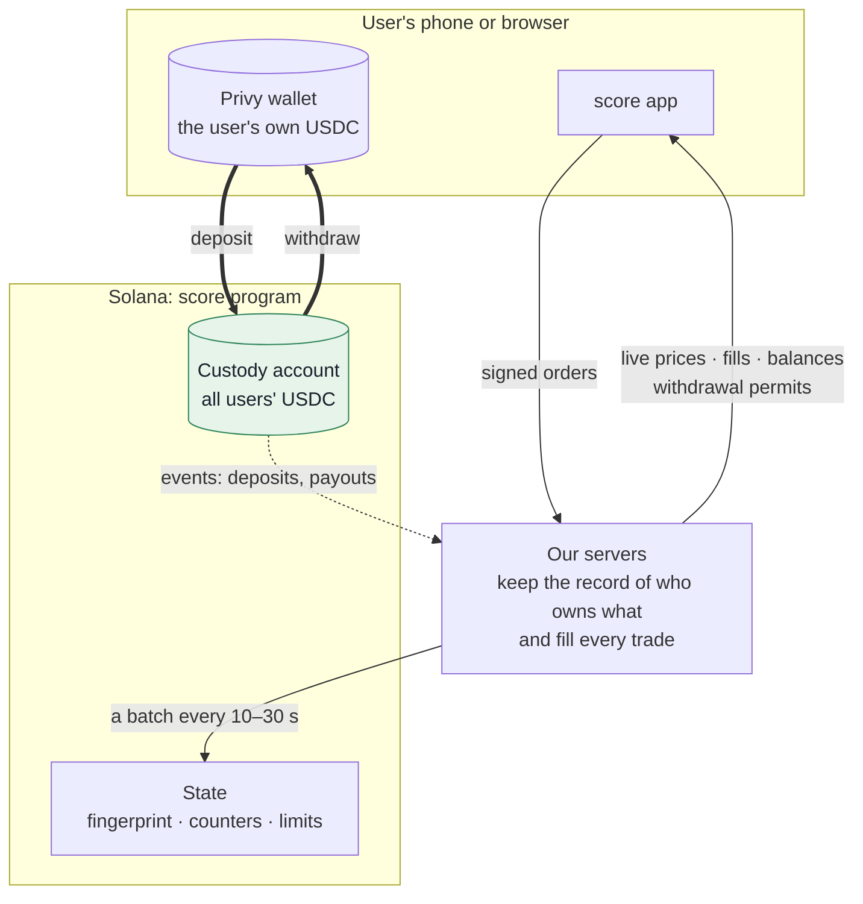

- **Money moves only between the user's wallet and the custody account,** in Solana transactions the user signs.
- **Orders never touch Solana.** They go from the app to our servers and are filled there.
- **Our servers report to the program every 10–30 seconds,** and the program checks that report against the money it holds.

### 2.2 Inside our servers

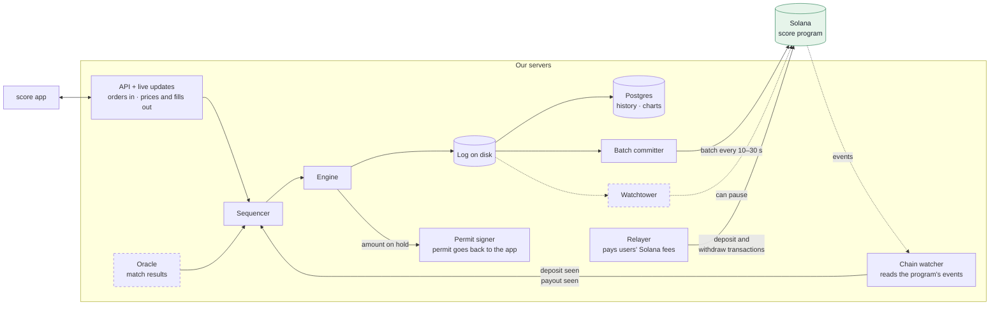

**One rule holds everything together:** every change, without exception, goes through the sequencer and lands in the log first. That covers:
- trades;
- deposits and withdrawals;
- dividends;
- admin changes.

The engine's memory, Postgres, the charts and the fingerprint are all rebuilt from the log. If they disagree with it, the log wins.

### 2.3 The pieces

| Piece | What it does | Runs on | Status |
|---|---|---|---|
| **score app** | The screens. Signs each order with the user's wallet key (no popup) | Vercel | Built (on mock data) |
| **Privy wallet** | The user's own wallet. Holds only USDC; users never need SOL | User's device | To connect |
| **API + live updates** | Takes orders in; streams prices, fills and balances out over a WebSocket | Railway, later AWS | Built (`score-node`), tested on devnet |
| **Sequencer** | Checks each order's signature, gives it the next number and the time, and puts it in one line | Engine machine | Built |
| **Engine** | Applies each action: curve, pools, order book, liquidity, fees, sell tax, rounds, claims | Engine machine (in memory) | Built, 45 tests |
| **Log** | Saves every action to disk before we say "done". Replaying it rebuilds everything exactly | Engine machine disk, plus a standby copy later | Built |
| **Permit signer** | Signs a withdrawal permit once the engine has put the amount on hold | Server; key in a hardware vault on mainnet | Built, tested on devnet |
| **Relayer** | Pays the Solana fee on users' deposit and withdrawal transactions; refuses anything else | Server | Built, tested on devnet |
| **Chain watcher** | Reads the program's events at finalized, catches up from history after gaps | Server | Built, tested on devnet (incl. restart catch-up) |
| **Batch committer** | Every 10–30 s, and straight away when a large withdrawal or a round result is waiting: works out the fingerprint and posts it to the program | Server (a second copy of the engine replaying the log) | Built, tested on devnet |
| **Postgres (Neon)** | Trade history, candles, portfolio. Not on the trading path, so it can't slow trades down | Neon | Built; waiting for the Neon database to test |
| **Oracle** | Match calendar, scores, and the dividend amount per player each round | Server | Plan step 4 |
| **Watchtower** | An independent copy that replays the public log, checks every number, and can pause | Separate machine | Later |
| **score program** | Holds the USDC, enforces the rules for money in and out, checks each batch | Solana | Built, 22 tests, deployed on devnet |

---

## 3. Inside the score engine

### 3.1 What happens to one action

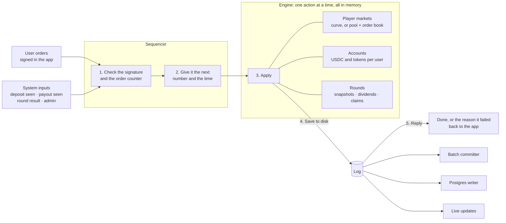

The rules the engine follows:

- **All or nothing.** An action either fully happens or doesn't happen at all. A failed order changes nothing.
- **Same log in, same result out.** The engine never uses randomness, reads the clock, or uses decimals. All maths is in whole numbers, and rounding always goes in the protocol's favour, so it can never pay out a fraction it doesn't have. Anyone who replays the log gets the same balances to the last micro-cent. That is what lets a watchtower check us now, and a proof later.
- **Save before saying yes.** The reply goes out only after the action is on disk. Many actions share one disk write, which keeps this fast.
- **Every user order carries the user's signature.** The signature is stored in the log, so we can't invent trades for anyone.

**Speed:**
- **Engine:** an order takes about 31 µs in a typical case and 42 µs in the slowest 1%, including the signature check. That is about 30,000 orders a second on one core.
- **Disk:** saving to disk adds about 4 ms.

### 3.2 Life of a player market

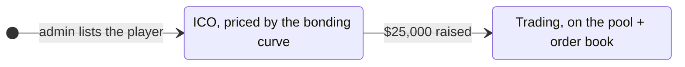

- **ICO (bonding curve).** Each player has 10M tokens.
  - The price starts at $0.00039 and rises with the square of the number of tokens sold, so early buyers pay less.
  - Every buy and sell goes against the curve.
  - There is a 1.25% fee, and no one can buy more than 240,000 tokens in one go or in total.
- **Graduation** happens inside the order that takes the raise past $25,000.
  - The order fills on the curve up to exactly $25,000. Whatever is left of it buys from the new pool straight away, so the order always fills completely.
  - The $25,000 is split three ways:
    - **70%** plus about 1.6M tokens goes into the new pool, placed in three fixed price bands around the opening price. This is the *protocol seed*: it can never be withdrawn.
    - **20%** goes to the **dividend vault**.
    - **10%** goes to the **treasury**.
- **Trading.** Users trade against the pool and against each other's limit orders. They can also add their own liquidity to the pool and earn its fees.

Of each player's 10M tokens:
- **8M** are for sale: sold on the curve, then put in the pool at graduation.
- **2M** are a reserve, paid out only when a holder takes a dividend as tokens (+10%).

Player tokens are entries in the engine, not Solana tokens, and they never leave the app.

### 3.3 How a trade gets filled

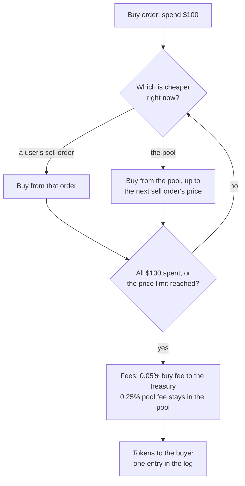

- **Selling works the same way**, from the other side.
- **Sell tax** depends on how long the seller has held the tokens: 5% at first, falling to 0.5% after 90 days. 90% of it goes to the dividend vault and 10% to the treasury.
  - It applies whether the seller sells to the pool or to another user, so the order book can't be used to dodge it.
- **Holding time** is an average. Buying more blends the new tokens in, so a top-up doesn't reset it to zero, and moving tokens into or out of the pool doesn't reset it either.
- **Your own orders.** If you would trade against your own resting order, that order is cancelled instead.

### 3.4 How the price is set (trading is off-chain, so where does it come from?)

No outside price feed is needed. The price comes from the pool's own balances, the same way it does on Uniswap or Orca. The only difference is that our engine does the arithmetic instead of a Solana program.

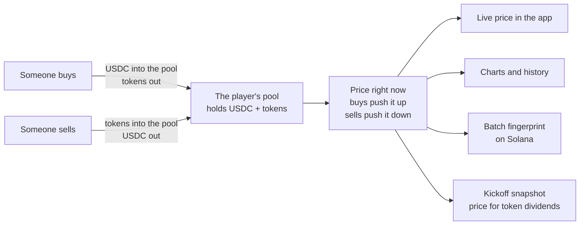

- **During the ICO,** the price is the curve formula applied to the number of tokens sold.
- **The order book doesn't set the price.** User orders sit around the pool price, and the router fills from whichever is cheaper. The best buy order is always at or below the pool price, and the best sell order at or above it.
- **Anyone can recompute the price.** It depends only on the trades in the public log, so replaying the log gives the same price.
- **It is committed on Solana.** The price is part of every batch fingerprint posted on-chain.
- **Dividends taken as tokens** use the pool price at the round's kickoff snapshot. An average price over a time window is a possible upgrade, because it is harder to push around just before kickoff.

### 3.5 The maths: numbers and rounding

Every price, fee and payout is computed in whole numbers. Whenever a division leaves a remainder, the rounding direction is chosen so the pool or the protocol never pays out money it doesn't hold. The formulas below are the ones in `engine/score-engine/src/` (`math.rs`, `fixed.rs`, `clmm.rs`, `pool.rs`, `market.rs`).

| Quantity | Unit | Why |
|---|---|---|
| USDC | micro-USDC (1 USDC = 1,000,000) | USDC's 6 decimals on Solana |
| Player tokens | base units (1 token = 1,000,000) | Same precision as USDC |
| Curve maths | milli-tokens (1 token = 1,000) | Keeps the cubes in the curve formula inside 128 bits |
| Pool price | √(USDC per token) × 2⁶⁴, as an integer (Q64.64) | Uniswap v3's representation |
| Order book price | USD per token × 10⁹ | Fine-grained limit prices |

- **Checked 128-bit integers everywhere.** An overflow is an error, never a silent wrap.
- **Multiply-then-divide runs in 256 bits** (`mul_div`), so `a × b / d` loses nothing before the division, and the caller picks floor or ceiling.
- **Square roots** use integer Newton iteration from an over-estimate, which returns exactly ⌊√n⌋.
- **Pool price bounds:** √price from 2⁴⁰ to 2⁸⁸ in Q64.64 (about 3.6 × 10⁻¹⁵ to 2.8 × 10¹⁴ USD per token), and liquidity at most 2⁹⁶. Those bounds prove every intermediate fits in 256 bits: L·2⁶⁴·√p < 2⁹⁶·2⁶⁴·2⁸⁸ = 2²⁴⁸.

**The rounding rule:**

| Case | Rounds | So that |
|---|---|---|
| Anything the pool or protocol receives | Up | Users never underpay |
| Anything the pool or protocol pays out | Down | It never pays a fraction it doesn't hold |
| Fees | Up | The protocol never under-collects |
| Liquidity credited for a deposit | Down | A depositor can't take out more than they put in |
| The pool's next price after a trade | Moves less than the exact value | The pool always comes out slightly ahead |
| Dividend, graduation and exit splits | Down | Leftover fractions stay in the pot |

### 3.6 The maths: the bonding curve and graduation

**Price.** With `s` = tokens sold in milli-tokens and `Q = 3,883,000,000`:

```
price(s) = 390 + s² / (Q · 10⁶)          micro-USDC per whole token   (starts at $0.00039)
```

**Cost** of buying `Δ` milli-tokens from `s` is the exact integral of the price, in integers:

```
cost(s, Δ)   = ⌈ ( 390 · Δ · 3Q · 10⁶  +  (s + Δ)³ − s³ )  /  (3Q · 10⁹) ⌉
refund(s, Δ) = ⌊ same numerator, from s − Δ ⌋
```

- A buy rounds the cost up and a sell rounds the refund down, so a buy followed by a sell can never profit from rounding.
- **"How many tokens does $X buy?"** is a binary search for the largest `Δ` with `cost(s, Δ) ≤ X` (about 33 steps over the 8M-token float).
- **Limits:** 1.25% fee, 8M tokens for sale, at most 240,000 tokens (3% of the float) per purchase and per account.

**Graduation**, inside the order that crosses $25,000:
1. A second binary search finds the smallest `Δ` with `cost(s, Δ) ≥ $25,000 − raised`. That part fills on the curve.
2. `seed = ⌊70% · raised⌋`, `vault = ⌊20% · raised⌋`, `treasury = raised − seed − vault`.
3. `pool_tokens = seed / price(s)` at the curve's closing price, and the pool opens at `√p₀ = √(seed · 2¹²⁸ / pool_tokens)`.
4. The seed is placed as a fixed ladder around p₀: 30% in [0.75·p₀, 1.33·p₀], 30% in [0.4·p₀, 2.5·p₀], and the rest across the full range. Rounding dust that no slice can use goes to the dividend vault.
5. The rest of the order buys from the new pool in the same command.

In the reference program, a buy that overshoots $25,000 by about $0.50 or more makes `graduate` fail its own 8M-token check, so the market can never graduate. Clipping at exactly the threshold removes that case.

### 3.7 The maths: the concentrated-liquidity pool

The pool is Uniswap v3's maths (`SqrtPriceMath`, `SwapMath`, `LiquidityAmounts`) ported to Q64.64 with the same rounding rules. Token 0 is the player token (x), token 1 is USDC (y), and price = y / x.

**Amounts in a range** [√a, √b] for liquidity L:

```
Δx = L · (√b − √a) · 2⁶⁴ / (√a · √b)        player tokens
Δy = L · (√b − √a) / 2⁶⁴                     USDC
```

Up when the pool receives, down when it pays.

**Next price after an input:**

```
USDC in (price rises):    √p' = √p + Δy · 2⁶⁴ / L                          rounded down
tokens in (price falls):  √p' = L · 2⁶⁴ · √p / (L · 2⁶⁴ + Δx · √p)         rounded up
```

**A swap** repeats Uniswap v3's exact-input `computeSwapStep` until the input runs out or the price reaches the limit:
1. Target the next range boundary in the trade's direction, or the limit, whichever comes first.
2. Take the 0.25% fee from the input, move the price within the current liquidity, and compute what comes out.
3. On reaching a boundary, add or subtract that boundary's net liquidity and continue.

Two differences from Uniswap v3:
- **Exact boundaries instead of ticks.** Ranges are keyed by their exact √price. A `just_below` flag plays the role of v3's `tick = tickNext − 1` when a downward swap stops exactly on a boundary.
- **Simulate, then apply.** `sim_swap` runs on a copy of the pool and records the boundaries it crosses. `apply` commits it only after the order passes its slippage check, and re-checks the reserves first. A rejected order never leaves a half-applied trade.

**LP fees** use v3's fee growth per unit of liquidity (Q64.64, wrapping):

```
fee_growth  += fee · 2⁶⁴ / L                         each swap step, in the input token
fee_inside   = fee_growth − below(lower) − above(upper)
fee_owed     = ⌊ L_position · Δfee_inside / 2⁶⁴ ⌋
```

Each boundary stores the fee growth "outside" it and flips it on every crossing (`outside = global − outside`). That gives any position's earned fees exactly, in constant time.

**Adding liquidity:** `L = min( x · √a·√b / ((√b − √a) · 2⁶⁴),  y · 2⁶⁴ / (√b − √a) )` for a range around the price (v3 `getLiquidityForAmounts`), rounded down. The deposit's amounts then round up and the withdrawal's round down.

**Solvency:** the pool's reserves hold everything paid in, and every payout rounds down, so the reserves always cover every position's principal plus earned fees. The tests check this after every action.

### 3.8 The maths: routing, fees, tax and dividends

**Routing** (`market.rs`):
1. The book is price-time priority: best price, then earliest.
2. A taker fills from the cheaper venue. The pool is swapped only until its price reaches the next resting order's price (or the taker's limit). Then that order fills, and so on. At equal prices the book goes first.
3. The whole fill is planned read-only (`plan_buy` / `plan_sell`), checked against the slippage bound, and only then committed.
4. A taker that reaches its own resting order cancels and refunds it, so the book never ends up crossed against the pool.

**Fees and tax:**

```
fee(amount, bps) = ⌈ amount · bps / 10,000 ⌉

tax_bps(age)     = 500 − 450 · min(age, 90 days) / 90 days        5% → 0.5%
entry_time'      = (entry · old_tokens + now · new_tokens) / (old_tokens + new_tokens)

split(tax)       = vault ⌊90%⌋, treasury the rest
```

- The 0.05% buy fee is charged on the USDC actually routed. The 0.25% LP fee applies to pool legs only.
- A taker seller pays the tax on the gross USDC received; a maker seller (a resting ask) pays it on each fill.

**Dividends:**

```
holder's share     = ⌊ holder_tokens · player_dividend / snapshot_total ⌋
token election     = ⌊ dividend_usdc · 1.10 / snapshot_price ⌋       (from the 2M reserve)
```

### 3.9 How the maths is tested

- **Exact rationals:** each fixed-point and pool primitive is compared against exact big-integer fractions over hundreds of thousands of cases. Rounding must be exactly floor or ceiling in the stated direction.
- **Pool fuzzing:** random ranges, swaps and withdrawals. The pool must always cover every position's principal and fees; round trips never profit; splitting a trade never beats one trade; a full-range position must agree with the constant-product formula.
- **Engine fuzzing:** random sequences of every command. After each one the full invariant set holds (§4.3 and `invariants.rs`): custody equals liabilities exactly, tokens are conserved, the book and pool are consistent, LP bookkeeping adds up, and the exit table is backed by custody. Rejected commands change nothing, and the log replays to the same state root.
- **Mutation checks:** deliberately broken rounding, fee accounting and routing are each caught.

---

## 4. Where the money sits

### 4.1 On Solana: the program's accounts

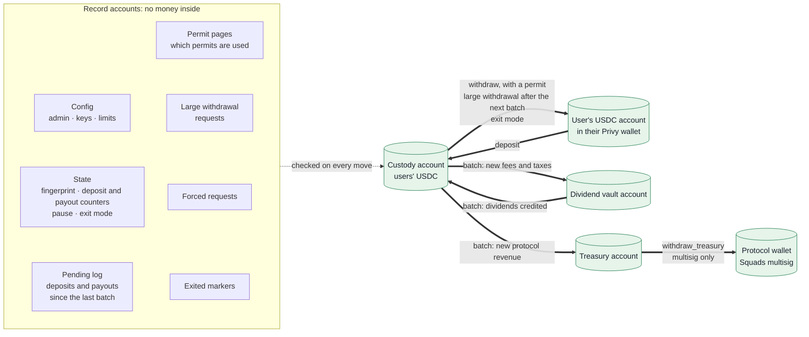

| Account | What's in it | Who can change it | How many |
|---|---|---|---|
| **Custody account** | Users' USDC: balances, orders, pools, unclaimed dividends. Plus the fees earned since the last batch, until that batch moves them out | Only the program, by its rules | One |
| **Dividend vault account** | USDC set aside for future dividends | Only a batch (in from custody, back to custody when dividends are credited) | One |
| **Treasury account** | Protocol revenue | In: only a batch, and a batch can only add. Out: only the multisig's `withdraw_treasury` | One |
| **Three authorities** | Nothing. Each is the program's signature for one of the three token accounts above (a "PDA": an address with no private key) | The program only | Three |
| **Config** | The admin, the three service keys, the limits | The admin | One |
| **State** | The latest fingerprint and exit table, the deposit and payout counters, how much the treasury may withdraw, pause and exit-mode flags | The program, during each instruction | One |
| **Permit page** | One bit per permit id (8,192 per page), so each permit works only once | The program | One per 8,192 withdrawals (about 0.008 SOL each) |
| **Large withdrawal request** | One withdrawal above the cap, waiting for the next batch | The program; closed when paid, rent refunded | Only while waiting |
| **Forced request** | A user's request that the engine must serve | The user creates it and pays | Rare |
| **Exited marker** | Shows a user has already been paid in exit mode | The program | Only in exit mode |
| **Pending log** | Every deposit and payout since the last batch: who, how much, which permit | The program, on every deposit and payout | One (~98 KB, ~0.5 SOL rent, one time) |

The program stores no balance for any user. The engine keeps all of those, and the chain only holds the fingerprint of them. That's why trades cost nothing on Solana and no one pays rent for an account per user.

Each money account has its **own authority**, so an instruction can only move money from the account it signs for:
- `withdraw_treasury` can sign only for the treasury, so the multisig can never reach user money;
- a batch can add to the treasury but never take from it.

### 4.2 How the engine and the accounts stay in sync

The engine's balances are a record of who owns which part of the USDC. Most changes to them never move USDC on Solana. When Alice buys from Bob, Alice's balance goes down and Bob's goes up, all inside custody. Only four things move USDC between accounts, each at a fixed point:

**The rule:** whichever side gives up money moves first. The engine moves first only when it *reduces* what users can spend. Anything that *increases* what users can spend waits until the USDC is on Solana, in a **finalized** block. "Confirmed" (optimistic) is never enough.

| What happens | Which side moves first | How the other side catches up | If the Solana side fails |
|---|---|---|---|
| Deposit | Solana: wallet → custody | Once the deposit is **finalized**, the watcher reports "deposit n", and the engine credits it (only n, right after n−1) | Nothing was credited |
| Withdrawal | Engine: the amount goes on hold (users can spend less), and a permit is issued | The user's transaction pays it. Once **finalized**, the watcher reports "payout n" (numbered like deposits), and the engine removes the hold | The hold stays. It's released only when finalized Solana state shows the permit expired unused, and only after the engine has applied every payout up to that point |
| Fees and taxes | Engine: its vault and treasury figures grow (users can't spend that money) | Each batch moves the difference since the last batch from custody into the vault and treasury accounts | Custody keeps the extra until the next batch |
| Dividends | **Solana first:** the round result only *sets aside* the payout; the next batch moves it from the vault into custody | Once that batch is **finalized**, the watcher reports it, and the engine credits the holders | Nobody was credited. The next batch moves the same amount |
| Treasury withdrawal | Solana: multisig → protocol wallet | Once **finalized**, the watcher reports "payout n", and the engine lowers its treasury figure | Nothing changed |

The program records the vault and treasury figures of every batch, so a batch can only move "new figure minus last figure". A failed batch simply means the next one moves the larger difference: nothing is moved twice or skipped. After the move, it checks that custody still covers everything owed to users.

**Every report from Solana is numbered** (deposit n, payout n), so a missed or repeated report is refused instead of silently skipped. Every batch is also checked on-chain against the program's own counts.

### 4.3 The engine's boxes

Every dollar in the three money accounts belongs to exactly one of these boxes. The dividend vault and treasury boxes live in their own accounts; the rest live in custody. Three small diagrams show how money moves between them.

**Trading** moves money between users' free balances and the markets:

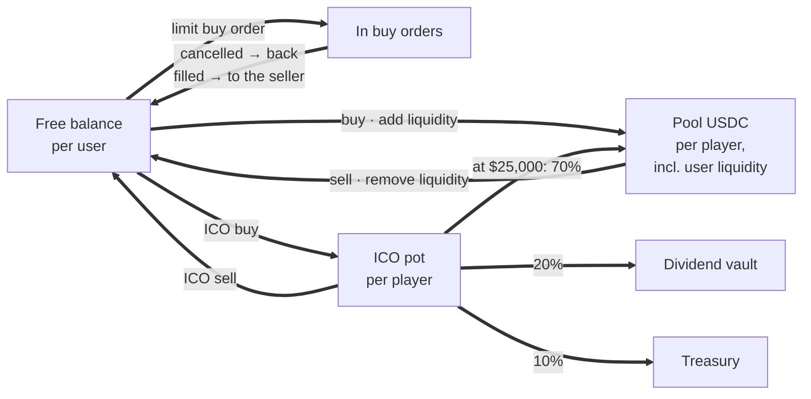

A trade between two users, through the order book, moves USDC from the buyer's balance to the seller's.

**Fees and dividends** fill the dividend vault and the treasury, and pay holders:

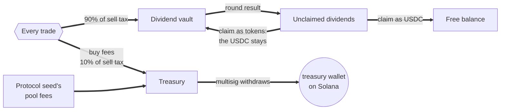

**In and out** is the only path between a user's wallet and these boxes:

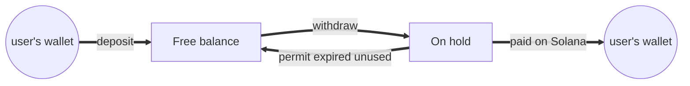

**The check that keeps it honest:**

```
custody + vault + treasury USDC  =  free balances  +  on hold  +  in buy orders  +  ICO pots
                                 +  pool USDC  +  unclaimed dividends  +  dividend vault  +  treasury
```

This is an exact equality, not just "at least":
- **In the tests,** it is checked after every single action, across thousands of random trading runs.
- **On Solana,** every batch moves the vault and treasury figures into their accounts, then checks that custody covers everything else (what users are owed).

### 4.4 Fees: who pays what, and where it goes

| When | Charge | Goes to |
|---|---|---|
| ICO buy | 1.25% | Treasury |
| ICO sell | 1.25% | 90% dividend vault, 10% treasury |
| Graduation | The $25,000 raised | 70% pool (locked forever), 20% dividend vault, 10% treasury |
| Buy after graduation | 0.05% | Treasury |
| Any trade against the pool | 0.25% pool fee | Stays in the pool. Liquidity providers earn it by their share |
| Sell after graduation | Sell tax: 5%, falling to 0.5% over 90 days of holding | 90% dividend vault, 10% treasury |
| The protocol seed's share of pool fees | Its part of the 0.25% | Treasury (a setting can send part to the dividend vault). The token part is destroyed |
| Dividend taken as tokens | +10% bonus tokens from the player's reserve | The USDC stays in the dividend vault for future rounds |

---

## 5. Money in and out, step by step

### 5.1 Deposit (spendable in about 1 second)

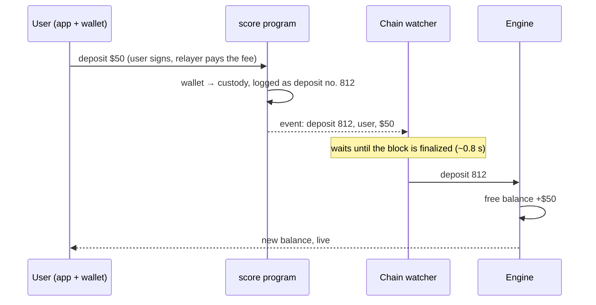

The money becomes spendable only once its block is finalized. Since Solana's Alpenglow upgrade (mainnet, 21 Oct 2026), "confirmed" and "finalized" are the same moment. On devnet we measured finality at 0.79 s median after sending (0.43–1.6 s, 12 transactions), so waiting for finality costs no time.

**A deposit can't be lost or counted twice:**
- The program counts every deposit and keeps a running fingerprint of all of them.
- The engine only accepts deposit 812 right after 811.
- Each batch must say exactly how many deposits it includes, and the program checks that against its own count. If the engine skipped one, the next batch would fail.

### 5.2 Withdrawal (about 1 second)

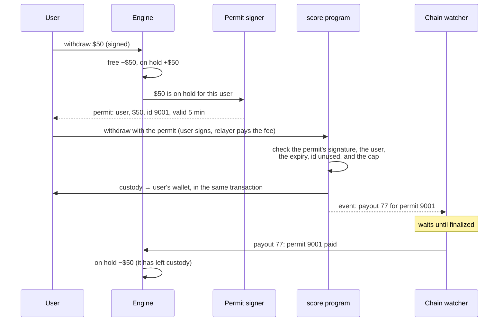

**Why the permit is needed.** The program can't see live balances, because they change with every trade in the engine. So the engine signs a short note saying *"this $50 is set aside for this user and can't be spent on anything else."*

**The permit is safe on its own.** It:
- only pays the user who signs the transaction;
- works once;
- expires after a few minutes.

**The cap.** Instant withdrawals made since the last batch can't add up to more than a limit. For example, the larger of $25,000 and 2% of custody (numbers to be agreed with the client). If the permit key were ever stolen, that is the most it could take before the next batch check and a pause stop it.

**If the permit is never used,** the amount stays on hold until all three of these are true:
- the watcher sees, in finalized Solana state, a block whose clock is past the permit's expiry, with the permit still unused;
- the engine has applied every payout up to that point, so a payout of this permit can't still be on its way;
- 60 seconds of margin have passed on the engine's clock.

Only then does it go back to the free balance. The program refuses an expired permit, so the money can't be both returned and paid out.

### 5.3 Large withdrawal (above the cap)

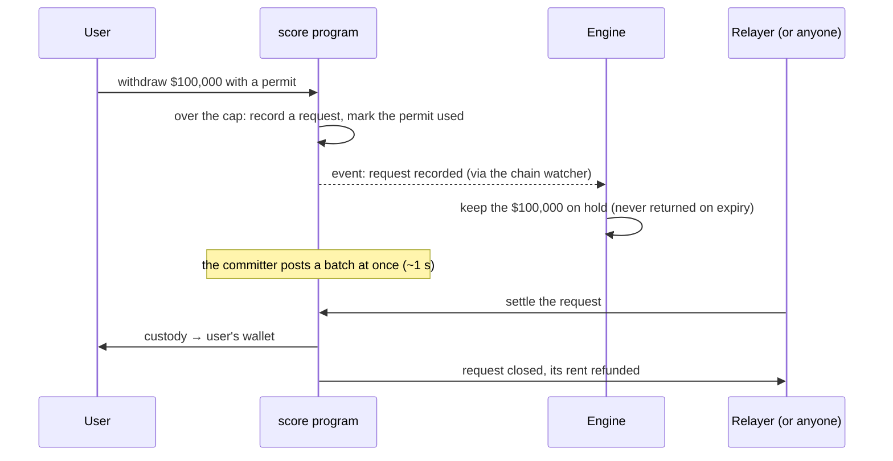

### 5.4 Treasury withdrawal

1. Each batch moves new protocol revenue from custody into the treasury account, and records the engine's treasury figure.
2. The multisig withdraws from the treasury account (never from custody), up to that figure, to any USDC account it chooses.
3. The chain watcher tells the engine, and the engine lowers its treasury figure.
4. Only one treasury withdrawal is allowed at a time. The next batch must show the engine has recorded it.
5. Treasury withdrawals don't count against the users' instant-withdrawal cap.

---

## 6. Batches: how Solana keeps the engine honest

Every 10 to 30 seconds, the batch committer sends one small transaction. The committer is a second copy of the engine that replays the log, and the operator key signs the batch.

Five layers make the engine's record checkable. Each is a hash (SHA-256), and each starts with its own fixed label (domain separation), so a hash made for one purpose can never be passed off as another. The byte formats are a contract between `score-engine` and the program (`verify.rs`): they change only together.

### 6.1 Layer 1: user signatures

Every user command is valid only with an Ed25519 signature by the user's Solana wallet key (`auth.rs`):

```
signature = ed25519( user_key, "score:order:v1:" || borsh(command) )
```

The signature is stored in the log next to the command. Anyone replaying the log checks it, so the operator can't invent, change or replay a user's order.

Withdrawal permits are signed the same way by the permit key and checked on-chain through Solana's Ed25519 program. The permit binds the program id, so it can't be replayed against another deployment:

```
permit = "score:voucher:v1:" || program_id || user || amount || id || expiry
```

### 6.2 Layer 2: the hash-chained log

Every accepted command is chained to the one before it (`wal.rs`):

```
h_n = SHA256( "score:log:v1:" || h_(n−1) || seq_n || ts_n || borsh(cmd_n) || borsh(sig_n) )
```

- Changing, removing or reordering any past command changes every hash after it.
- The latest hash (the *log head*) goes into every batch, so the log up to that batch is fixed on-chain.
- `Sequencer::replay` rebuilds the state from genesis, checking every sequence number, timestamp, signature and hash.
- **On disk,** each record is a frame `len (u32) | crc32 (u32) | borsh(record)`. Many records share one `fsync` (group commit). After a crash, a torn last frame is detected by its CRC and trimmed; corruption anywhere else is an error, never a guess.

### 6.3 Layer 3: the state root

The *fingerprint* is the root of a Merkle tree over the whole engine state (`state_root.rs`):

```
leaf = SHA256( 0x00 || tag || borsh(key) || borsh(value) )
node = SHA256( 0x01 || left || right )
```

1. One leaf per state entry, in a fixed order: by tag, then by key within each map. The same state always gives the same root.
2. Leaves are hashed in pairs, then the pairs in pairs, up to one root.
3. An unpaired node is carried up unchanged, not duplicated.

| Tag | One leaf per |
|---|---|
| `glob` | The globals: parameters, pause flag, custody, vault, treasury, claimable, reserved, deposit / payout / forced counters, next order and LP ids, last snapshot and result |
| `acct` | User account: free, on hold, in orders |
| `hold` | User × player holding, with its weighted entry time |
| `mrkt` | Player market: ICO or bonded, raised, sold |
| `pool` | Pool header: √price, liquidity, `just_below`, fee growth, reserves |
| `bnd_` | Pool boundary: gross and net liquidity, fee growth outside |
| `ordr` | Resting order (the book's levels are exactly these, sorted by id) |
| `lpos` | Liquidity position |
| `lock` | Withdrawal on hold |
| `cal_` `snap` `elpx` `clm_` `prnd` | Calendar, kickoff snapshots, token-election prices, unclaimed dividends, rounds awaiting credit |

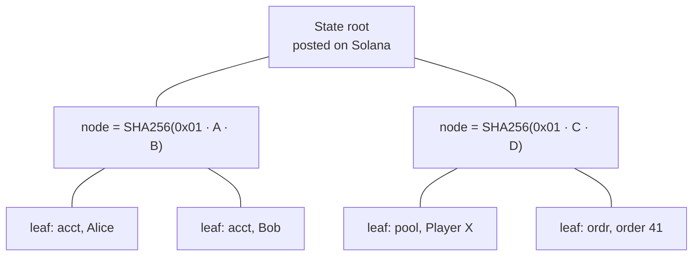

**Why `0x00` / `0x01` and no duplication:** a leaf can never be passed off as a node, and two different leaf lists can never give the same root (the second-preimage weaknesses of naive Merkle trees).

**Why a tree:** proving one entry needs only that entry plus one sibling hash per level, about 20 hashes for a million entries. `proof()` builds the path, and `verify()` (engine) and `verify_proof()` (program) check it the same way.

### 6.4 Layer 4: the exit root

Next to the state root, each batch commits a second tree: what each user is paid if exit mode starts (`exit.rs`):

```
exit_leaf = SHA256( 0x00 || "exit" || user || usdc (u64) || n (u32) || (lock_id (u64) || amount (u64)) × n )
```

- `usdc` = free + in buy orders + unclaimed dividends + dividends set aside for them + the USDC side and USDC fees of their LP positions + a pro-rata share of each pool's remaining USDC for every token they hold (free, in asks, and in LP positions), with no sell tax. For ICO-stage players, tokens redeem pro rata from the curve's raised USDC.
- Withdrawals on hold are listed separately with their permit ids, so the program can tell which were already paid.
- Every pot is divided with floor rounding, so the table never pays out more than custody holds.

### 6.5 Layer 5: the program's own money chains

The program keeps its own hash chains of every deposit and payout, independent of the engine (`verify.rs`):

```
deposit_hash_n = SHA256( "score:deposit:v1:" || deposit_hash_(n−1) || n || user || amount )
payout_hash_n  = SHA256( "score:payout:v1:"  || payout_hash_(n−1)  || n || kind || id || to || amount )
```

It also stores the last 32 checkpoints `(count, total, hash)` of each chain, so a batch can name any recent point on them.

### 6.6 What a batch contains

| Field | Meaning |
|---|---|
| `seq` | Batch number |
| `prev_state_root` | The root this batch builds on |
| `state_root` | The new fingerprint (§6.3) |
| `exit_root` | The new exit table (§6.4) |
| `log_head` | The latest log hash (§6.2) |
| `deposits`, `deposit_hash` | Deposits the engine has applied, and the deposit chain's hash at that count |
| `payouts`, `payout_hash` | The same for payouts |
| `forced_served` | Forced requests answered so far |
| `liabilities` | Everything the engine owes (equal to its custody figure at the cut) |
| `vault`, `treasury` | The engine's vault and treasury figures at the cut |

### 6.7 What `commit_batch` checks

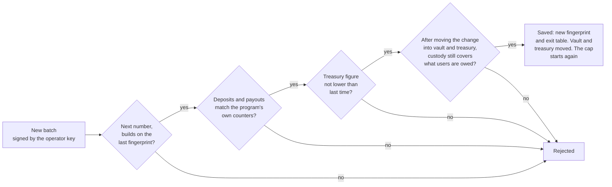

In detail (`commit_batch.rs`):
1. **Order:** `seq = last seq + 1` and `prev_state_root = stored state root`. No batch can be skipped, replayed or forked.
2. **Deposits:** `committed_deposits ≤ deposits ≤ deposit_count`, and `deposit_hash` equals the program's own chain at that count (from the head, genesis, or the 32-checkpoint ring). The engine can't invent a deposit or skip one.
3. **Payouts:** the same against the payout chain. A treasury withdrawal not yet covered by a batch must be inside this cut.
4. **Forced requests:** `forced_served` must equal the program's own count. Only `serve_forced` moves it.
5. **Treasury:** `treasury ≥ committed_treasury`. A batch can only add to the treasury.
6. **Reserves:** move the vault and treasury change, then adjust custody back to the batch's cut and check it covers what users are owed:

```
to_treasury = treasury − committed_treasury
to_vault    = vault − committed_vault                     (either sign)

custody − to_vault − to_treasury                ≥ 0
custody − to_vault − to_treasury
        + paid_since_cut − deposited_since_cut  ≥ liabilities − vault − treasury
```

If every check passes, the program stores the new roots, log head, cut counts and figures, and moves `to_vault` (custody ↔ vault) and `to_treasury` (custody → treasury). A rejected batch moves nothing; the next one moves the larger difference.

### 6.8 What this rules out

| If the operator tried to… | What stops it |
|---|---|
| Invent or alter a user's trade | No user signature; replaying the public log fails |
| Rewrite history | The log head and state root on Solana no longer match |
| Credit a deposit that never happened | The deposit chain hash doesn't match |
| Hide a withdrawal | The payout chain hash doesn't match |
| Report money custody doesn't hold | The reserves check rejects the batch |
| Skip a forced request | Only `serve_forced` marks it answered; past the deadline, exit mode |
| Stop posting batches | Exit mode after a set time; users withdraw with proofs (§7) |
| Take treasury money through a batch | A batch can only add to the treasury |

**What batches don't check yet (Phase 1).** The program doesn't check that every trade was worked out correctly; it trusts the operator's signature for that.
- **Today:** the public log and the watchtower cover this. Anyone can replay the log and compare the result with the fingerprint.
- **Phase 2:** a proof is added to each batch, so the program itself checks every trade. The engine is already written for this: whole numbers only, same log in, same result out. The program only needs one extra input.

---

## 7. When something goes wrong

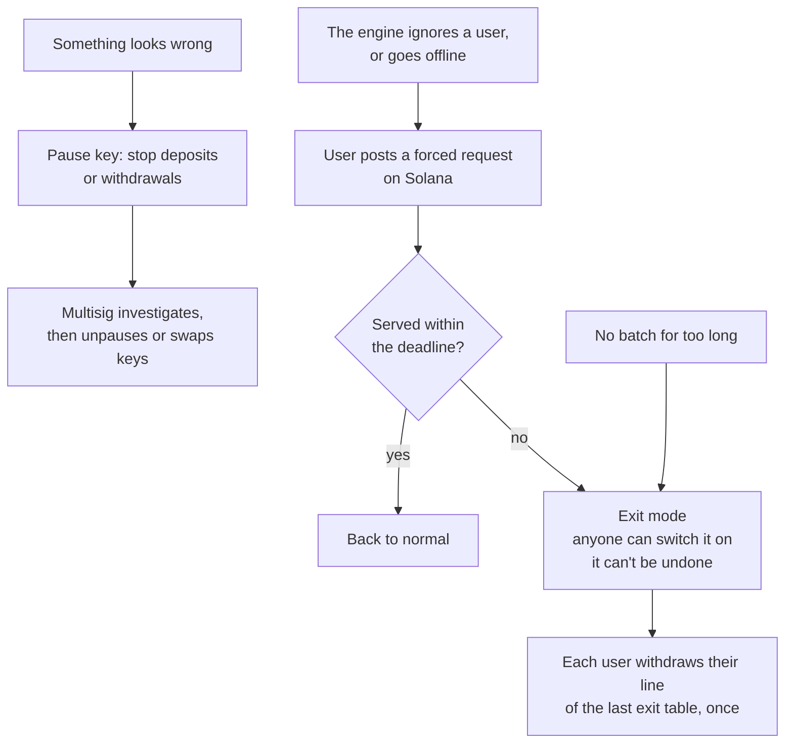

- **Pausing.**
  - The pause key can only pause; only the multisig can unpause.
  - A trading pause in the engine stops new trades only. Deposits, withdrawals, cancels, removing liquidity and claims keep working, so a pause never traps anyone's money.
- **Forced request.** If our servers ignore a user, or are down, the user can post a request directly on Solana: withdraw an amount (or everything free), or cancel one of their orders. The engine has to answer it within a deadline, for example 24 hours.
  - How it's answered: the watcher applies the request once it is final, and the engine puts the amount on hold. The committer then answers it on Solana with `serve_forced` inside the next batch transaction (no extra transaction), which pays the USDC straight into the user's wallet and returns their rent. Measured on devnet: about 3.7 s from posting to USDC in the wallet.
  - A batch can't mark a request answered; only `serve_forced` can, one at a time, in order. So a request can't be skipped quietly.
  - A request that asks for something impossible (no balance, someone else's order, an unknown kind) is still answered, with no effect, so nobody can use forced requests to stall us into exit mode.
  - With no USDC account to pay into, or withdrawals paused, it's answered without payment and the hold goes back to the user's balance.
- **The server follows the chain's switches.** It mirrors the on-chain pause flags and exit mode in memory. While withdrawals are paused it refuses them up front, so nothing goes on hold and no transaction fails. In exit mode it stops taking orders, permits and relays, and stops posting batches.
- **Exit mode.** If a forced request is ignored, or no batch arrives for a set time (for example 3 days), anyone can switch on exit mode. It is permanent. Each user is then paid once. They get their line of the last exit table, which holds:
  - their free USDC and their buy orders;
  - their unclaimed dividends;
  - the USDC side of their liquidity positions;
  - a fair share of each pool's USDC for the tokens they hold, with no sell tax;
  - any withdrawal on hold that was never paid.

  That line is then adjusted for what happened on Solana after the last batch:
  - deposits made after the batch are added, so no deposit is ever stuck;
  - withdrawals already paid after the batch are taken off, so no one is paid twice.

  The program keeps the deposits and payouts since the last batch in its **pending log**. To make that possible, deposits and withdrawals pause if they get more than 1,024 ahead of the last batch, and start again as soon as the next batch lands. Someone who only deposited after the last batch gets their deposits back with no proof needed. The app proves everyone else's line against the fingerprint on Solana, so the user doesn't have to do anything technical.

  **How `exit_withdraw` pays a user:**

  ```
  paid = max(0,  usdc                                   their exit leaf, proven against exit_root
              + locks in the leaf still unpaid           voucher bit never set, or an unsettled request
              + their deposits after the cut             read from the pending log
              − their permit payouts after the cut whose lock isn't in the leaf )
  ```

  1. The program rebuilds the user's exit leaf (§6.4) from their address, `usdc` and locks.
  2. It hashes the leaf up the tree with the sibling hashes the app supplies (at most 64), using `node = SHA256(0x01 || left || right)`, and requires the result to equal the stored `exit_root`.
  3. It creates an `Exited` marker at the user's address. Creating it again fails, so each user is paid once.
  4. The payment is added to the payout chain like any other.
- **The dividend vault and treasury** stay in their own accounts in exit mode, for the multisig to decide what happens to them. Exit payments come only from custody.

---

## 8. A round: dividends

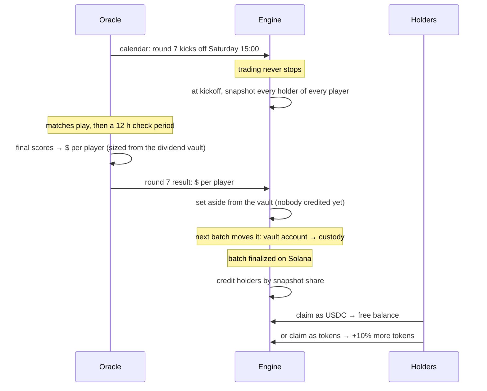

- **The snapshot is exact.** It counts every holder's tokens at kickoff, including tokens in sell orders and the token side of liquidity positions. The protocol seed doesn't count.
- **Dividends are chain-first.** The result only sets the money aside. The committer posts a batch straight away when a result arrives, and holders are credited once that batch is finalized, about 1–2 seconds later. Custody therefore always holds the USDC before anyone can claim or withdraw it.
- **The split always rounds down,** so the engine never pays out more than the vault holds. The leftover fractions stay in the vault.
- **Claiming as tokens** gives 10% more tokens from the player's reserve, priced at the snapshot. The USDC stays in the vault for future rounds.

---

## 9. Everything together: one user's week

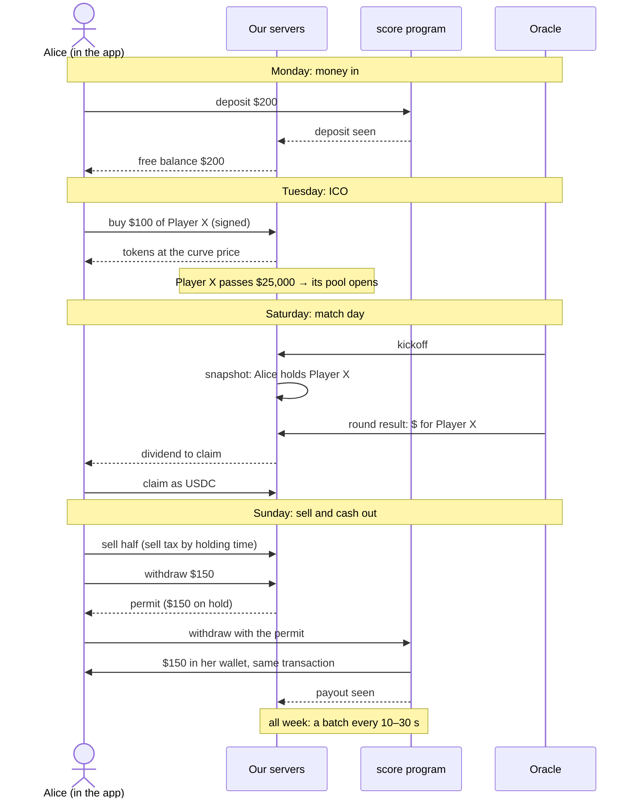

---

## 10. Keys: who can do what

| Key | Held by | Can | Can't |
|---|---|---|---|
| **Admin** | Squads multisig on mainnet; its own keypair on devnet | Change limits, swap the service keys, unpause, withdraw from the treasury account (up to the batch figure) | Touch custody or the dividend vault |
| **Operator** | Batch committer | Post batches, which move the vault and treasury change | Pay anyone; take from the treasury; post a batch that fails the checks in §6 |
| **Permit signer** | Permit service (hardware vault on mainnet) | Sign withdrawal permits | Pay anyone except the signing user; go over the cap; reuse a permit |
| **Pause key** | Watchtower / on-call person | Pause | Unpause |
| **User** | Their Privy wallet | Sign orders, deposit, withdraw their own money, post forced requests, exit | Act for anyone else |
| **Upgrade key** | The deployer wallet now; the multisig, with a delay, on mainnet | Upgrade the program. Only this key could run the one-time setup | |

On mainnet, the upgrade key must sit behind the multisig and a time delay, because whoever can upgrade the program can change its rules.

---

## 11. Where it runs, speed and cost

| Part | Now | Later |
|---|---|---|
| Engine, sequencer, log, services | Railway | AWS: a dedicated machine, plus a standby copy that saves every action too |
| Database | Neon Postgres | Same |
| Program | Ready for devnet | Mainnet, with upgrades through the multisig |
| App | Vercel | Same |

| What | Number |
|---|---|
| Engine time per order | ~31 µs typical, ~42 µs for the slowest 1% |
| Saving to disk | ~4 ms (measured on a laptop; server disks vary) |
| Deposit | 1 Solana transaction, ~$0.001 fee paid by the relayer. **Measured on devnet through our program:** sent → finalized → program event at the watcher in 1.09 s median (0.97–2.2 s, 15 deposits) |
| Withdrawal | 1 Solana transaction with the permit. **Measured on devnet:** sent → finalized in the user's wallet in 1.11 s median (0.96–1.35 s, 15 withdrawals) |
| Batch | Measured on devnet: finalized in 1.37 s |
| A trade | Nothing on Solana |
| A batch | 1 small transaction every 10–30 s, plus one straight away when a large withdrawal or a round result needs it |
| Program compute | deposit 7.9k, withdraw 10.4k, batch 7.7k (11.7k with both sweeps); worst-case exit 108k (a transaction may use up to 1.4M) |
| Putting the program on Solana | ~2.42 SOL, one time (477 KB), plus ~0.5 SOL for the pending log |

---

## 12. Built and next

| Status | What |
|---|---|
| **Built and tested** | The engine (45 tests, plus a 3,000-run random trading test), the program (22 tests on a local Solana simulator, deployed on devnet), the backend server (`score-node`: API, permit signer, relayer, chain watcher, batch committer, tested end to end on devnet, 12/12 checks), and the TypeScript client generated from the program |
| **Next** | Test the Postgres writer on Neon; switch the app from mock data to the real API (no visible change) |
| **Plan step 4** | The oracle: calendar, match data, scoring, round results |
| **Later** | Watchtower, standby copy, Phase 2 proofs |

---

## Words used in this doc

| Word | Meaning |
|---|---|
| **Custody account** | The one Solana account that holds every user's USDC |
| **Engine** | Our trading server's core. It keeps the record of who owns what and fills orders |
| **Sequencer** | The front door of the engine. It checks signatures and puts actions in one line |
| **Log** | The saved list of every action, in order. Everything else is rebuilt from it |
| **Batch** | The small transaction posted to Solana every 10–30 s |
| **Fingerprint** (state root) | A short code worked out from every balance. If any balance changed, the code would change, so once it's on Solana, history can't be quietly rewritten |
| **Exit table** | What each user gets if everything stops. Posted with every batch as the *exit root* |
| **Merkle tree / proof** | Hashes combined in pairs up to one root; a proof is the sibling hashes that tie one entry to the root |
| **Log head** | The latest hash of the hash-chained log, posted with every batch |
| **Q64.64** | A number stored as an integer scaled by 2⁶⁴; pool prices are kept this way |
| **Permit** (voucher) | The engine's signed note that an amount is on hold for one user's withdrawal |
| **Cap** | The most that can be withdrawn instantly between two batches |
| **Bonding curve / ICO** | A player's first sale, at a price set by a formula |
| **Graduation** | When a player's ICO reaches $25,000 and the pool opens |
| **Pool** | The player's built-in market maker. It always has a price and always trades |
| **Order book** | Users' limit orders to buy or sell at a set price |
| **Liquidity provider (LP)** | A user who adds USDC and tokens to the pool and earns its 0.25% fee |
| **Protocol seed** | The pool money from graduation. Locked forever |
| **Dividend vault** | USDC set aside for round dividends |
| **Treasury** | The protocol's revenue, withdrawn by the multisig |
| **Relayer** | Our server that pays Solana fees, so users never need SOL |
| **Multisig** | A wallet that needs several people to approve each action (Squads) |
