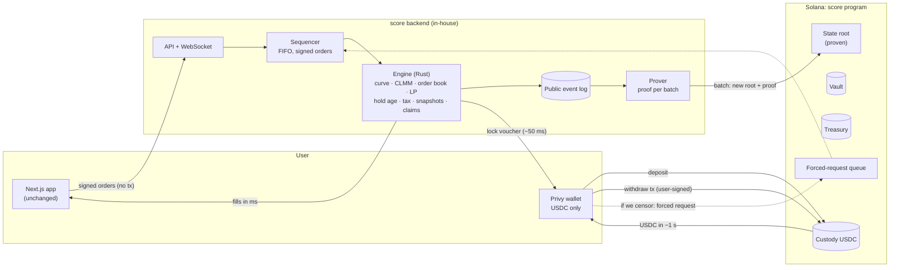

# score: choosing the execution model (draft 2)

> **Status: decided and built.** This was the design-stage decision doc. The recommendation (E, reached through B) was adopted, and Phase 1 (B) is now built and tested end to end on devnet: see `BACKEND.md` for how it works today. Phase 2 (validity proofs) is still to come. The rule it was judged against:
>
> **minimise latency and cost, maximise security and control, keep it flexible, and keep the product and UX unchanged.** Program effort doesn't matter.
>
> Costs below are computed from Solana's fee rules (5,000 lamports per signature, priority fee = CU × micro-lamports/CU, rent ≈ 6,960 lamports per byte incl. 128-byte header) at **SOL = $200**. Live prices and network figures couldn't be checked in this session (web search failed); every number tagged *(verify)* needs a check before sign-off.

---

## 0. Decided in review

| # | Decision |
|---|---|
| D1 | **Concentrated liquidity** for the protocol seed (and for user LPs). Plain x·y=k is out. §4 |
| D2 | **Event logs are published** so anyone can replay the engine. |
| D3 | **No protocol market making or protocol limit orders.** The treasury never trades. Risk minimised. |
| D4 | **Deposits and withdrawals are instant and on-chain.** Each is one Solana transaction that the user signs, and the program executes it and moves the USDC. No backend service sends, holds or approves a payout. They never wait for a batch or a proof. §4.1 |

---

## 1. The candidates

| | Approach | One line |
|---|---|---|
| **A** | Spec v3.0 as written | Anchor program; every trade, LP action and claim is a Solana transaction |
| **A\*** | Fully on-chain, optimised hard | Same as A, but Pinocchio, zero-copy, bitmaps instead of claim accounts, ZK-compressed positions, exact CU limits |
| **B** | Off-chain engine + on-chain custody (draft 1) | Engine executes; chain holds USDC, roots, reserves check, withdrawal limits |
| **C** | Off-chain matching + on-chain settlement | Engine matches; every few seconds the program re-executes the netted batch and enforces the rules |
| **D** | Ephemeral rollup (e.g. MagicBlock) | The same Anchor program runs on a fast delegated runtime and commits state back to Solana |
| **E** | **Validity-proven engine** | B's engine, but every batch carries a ZK proof that the engine followed the rules; the program verifies it before accepting the new state |

---

## 2. What the program can and can't optimise (A → A\*)

You were right that I hadn't looked at this. A fully on-chain program can be made much cheaper than the spec's Anchor version:

| Lever | Effect |
|---|---|
| **Pinocchio** (no Anchor), zero-copy accounts, no `msg!`, no heap | Trade from ~100–150k CU to ~15–30k CU *(benchmark)* |
| **Exact CU limit per tx** (`SetComputeUnitLimit`) | Priority fee scales with requested CU, so asking for 25k instead of the default 200k cuts it ~8× |
| **Claim bitmap on the position** instead of a `Claimed` account per claim | Removes ~$0.19 of rent per claim, which is the spec's biggest hidden cost (≈$20k/month at launch scale) |
| **ZK compression** (Light Protocol) for positions | No rent per position (spec: ~$0.41 each, ~$16k locked at launch) at the cost of a proof per update *(verify current CU cost)* |
| **Address lookup tables** | Smaller txs, more accounts per tx |
| **Close accounts on zero balance** | Rent returns to the relayer |
| **Market account per player, hot fields packed** | Fewer write locks, so trades on different players run in parallel |

**What it can't fix:**

- **A floor of 2 signatures per trade** (user + relayer) = 10,000 lamports ≈ **$0.002**, before any priority fee.
- **~400 ms per trade** to land, and longer when the network is busy. Optimistic UI hides some of this, not all.
- **Launch sniping.** Every launch is at a published time (14:00 / 20:00 UTC). Bots will use priority fees and Jito bundles to land first. That's both unfair and pushes the cost up: at 1,000,000 µL/CU, even a 25k-CU trade costs $0.007, and our relayer pays it for everyone.
- **Ordering within a block isn't ours.** Validators and searchers decide it (front-running and sandwiches within slippage).
- **An on-chain order book plus CLMM tick crossing** means much more CU per trade and write-lock contention on hot markets.

### Monthly chain cost (my model; assumptions in the header)

| Scale | A (spec) | A\* (optimised) | B | C / E (batch every 2 s) | C / E (batch every 30 s) |
|---|---|---|---|---|---|
| Launch: 5k users, 200k trades | **≈ $31k** + $16k rent locked | **≈ $0.7k** | ≈ $65 | ≈ $2.4k | ≈ $0.2k |
| Scale: 50k users, 5M trades | **≈ $319k** + $163k rent | **≈ $13k** | ≈ $250 | ≈ $2.5k | ≈ $0.4k |

Two things to notice:

- **A\*'s cost grows with every trade.** A batched design's cost is flat in time, so it barely grows with volume.
- C and E also carry **proving or compute cost per batch**, not in the table. For E this is the one number I can't estimate honestly without a benchmark (§6, item 1).

---

## 2b. "Engine off-chain, AMM and curves on-chain": what it can mean

Client direction (3 Nov): **no Meteora, no third-party LPs, everything in-house.** The client first floated real on-chain tokens so people could LP on Meteora. That was the only reason to want real tokens, so it is dropped.

### What the spec means by "on-chain"

Read from `docs/concept/scorespecification.pdf` (v3.0):

- **No SPL mint for players (§3).** Holdings are `Position{amount, entry_ts, …}` ledger entries in program accounts. Transfers happen only through the pool, so the program can enforce the sell tax, snapshots and hold age in one place.
- **The pool is not a standalone pool (§3, §6, §17).** It is constant-product reserves recorded in program accounts. The USDC sits in one shared custody account.
- **The real requirement is enforcement (§1).** The program is the only party trusted with money and "enforces all rules". Invariants I1–I10 are checked on-chain (§17.3).

So "curves, LPs and AMMs on-chain" means *the program computes and enforces every trade*. It does not mean player tokens must exist on Solana as SPL tokens. Ledger-entry tokens are the better fit: they keep the tax and snapshot enforcement the spec relies on.

### The ways to split it

| Version | Verdict |
|---|---|
| Pool reserves written by a program tx on every swap | This is the spec (A). It brings back per-trade cost, ~400 ms latency and sniping. |
| Engine fills instantly; every N seconds the program re-runs the batch and enforces the rules | Works (C), but every rule exists twice, and the CLMM and order book must fit in Solana compute. |
| **Engine fills instantly; each batch carries a ZK proof of correct execution; the program verifies it before accepting the new state** | **This is E.** The chain still enforces the rules, as the spec requires, but doesn't run each trade. |

### Recommendation: E, reached through B (unchanged from §4)

What the spec's guarantees become:

- **I1 (custody covers liabilities):** checked by the program on every batch.
- **I2–I10** (k never decreases, supply ≤ 10M, claims at most once, token conservation, and so on): they become the proof's constraints, and stay property tests on the engine.
- **Optional:** a read-only on-chain account per pool with reserves and price, updated each batch. It reads like an on-chain AMM without being one.

### What changes versus the spec

| Spec | Ours |
|---|---|
| `buy_curve`, `sell_curve`, `swap_buy`, `swap_sell`, `add_liquidity`, `remove_liquidity`, `claim`, `claim_lp` are Solana txs | Signed orders to the engine (no tx) |
| `graduate` is a separate call | Automatic, in the event that crosses $25k |
| `publish_rate` is one tx per player per round | One `commit_round` with a Merkle root of all rates |
| `Market`, `Position`, `LpPosition`, `Claimed`, `RoundRate` are PDAs (rent paid by the relayer) | Records in the engine's state tree (no rent) |
| `SnapBuf` keeps 8 snapshots per account | Exact snapshot of every holder per round |
| Privy policy: score program + USDC transfers | Applies only to `deposit` and `withdraw`; orders are signed messages the engine checks |
| Relayer pays fees on every action | Relayer pays only for deposit and withdraw |
| `init_config`, `set_paused`, `withdraw_treasury` | Stay on-chain |

### Not in v1

Real SPL tokens (withdraw ledger tokens as real tokens) are a possible later bridge. They would need their own design for the hold-age tax and kickoff snapshots, so they are out of scope until the client asks.

---

## 3. Comparison against the rule

Scores 1 (bad) to 5 (best), practical, today.

| | Latency | Cost | Security (can the operator steal, miscompute, or lock users in?) | Control (ordering, launches, rules, upgrades) | Flexibility (new features) | UX | Fails because |
|---|---|---|---|---|---|---|---|
| **A** | 2 | 1 | 5 | 2 | 2 | 3 | Cost and sniping |
| **A\*** | 2 | 3 | 5 | 2 | 2 | 3 | ~400 ms per trade, sniping, order book too heavy |
| **B** | 5 | 5 | **2** (operator can't forge user orders; miscomputation is only detectable after the fact) | 5 | 5 | 5 | Security relies on trusting us |
| **C** | 4 | 3 | 4 | 4 | **2** (every rule lives twice: in the engine and the program; the CLMM and book must fit in program CU) | 4 | Rigid and CU-bound |
| **D** | 4 | 4 | 3 *(verify how commits are secured)* | **2** (runtime and sequencer belong to a third party; USDC delegation is awkward) | 3 | 4 | Conflicts with "in-house" |
| **E** | 5 | 4 | **5** (the program accepts only proven state; users can force exits) | 5 | 4 | 5 | Most engineering; proving cost to benchmark |

**Only E is near the top on all four axes.** It's the same engine as B with one addition: a proof that the engine followed the rules. Security then comes from maths, not from trusting us, while we keep ordering and full control.

---

## 4. Recommendation: E, reached through B

### 4.1 The model

- **Trading stays exactly as fast as B.** The UI gets fills in milliseconds. Proofs run behind it.
- **Every few seconds to minutes,** a batch (events + old root + new root) is proven. The program verifies the proof, checks custody ≥ liabilities, and stores the new root. Trading, deposits and withdrawals don't wait for this.
- **Deposits are fully on-chain.** The user signs `deposit`, and the program moves USDC from their wallet to custody and appends it to an on-chain deposit hash. The engine credits it at *finalized* (originally proposed at confirmed, changed 2026-11-06; under Alpenglow finalized is reached as fast as confirmed, ~0.8 s measured on devnet). The engine can't ignore it, because the next batch has to consume exactly the deposits in that hash, no more and no fewer.
- **Withdrawals are fully on-chain.** The user signs and sends the `withdraw` transaction, and the program pays custody → the signer's wallet in that same transaction (~1 s). No operator key sends it, and no service holds a queue of payouts.
- **The one thing the program can't know by itself is the user's free balance right now.** That balance moves with every fill in the engine, and the chain only sees it at the last batch. So the app first asks the engine to **lock** the amount, which takes it off the trading balance so it can't also be spent on a trade. The engine returns a signed **voucher**: `{user, amount, id, expiry}`. This takes about 50 ms, and the user never sees it as a separate step. The program checks:
  - the voucher signature, that the tx signer is `user`, that `id` is unused (bitmap) and the voucher hasn't expired;
  - the **unproven exposure cap:** the total paid since the last proven root can't go above a cap (e.g. the larger of $25k and 2% of custody *(tune)*);
  - the **per-user cap per window,** so one account can't use the whole cap.
  
  Each payout goes into an on-chain withdrawal hash. The next proof has to show that each one matched a lock on a balance that really was free. If the voucher key is stolen or the engine has a bug, the proof fails. The program then stops paying vouchers and stops accepting batches, and users leave through the forced queue and exit mode. **The worst case is a loss of at most the exposure cap, and a reserve of the same size, funded by the treasury, covers it.**
- **Why not skip the voucher?** A withdrawal with no input from the engine could only pay against the last proven balance. But the user may already have spent that balance on a trade since, so they'd be paid twice. With off-chain trading, *instant* and *no engine input at all* can't both hold. The voucher is the smallest input that works: the engine only confirms "this much is free and now locked"; the program holds the money and does everything else.
- **If the engine won't issue a voucher** (it's down, or it's censoring), the user posts `force_request(withdraw)` on-chain. Either the next batches pay it within *T*, or the program enters exit mode.
- **Above the caps** (a very large withdrawal, or a rush that uses up the window), the user's withdrawal tx records the request on-chain, and the program pays it in the next `commit_batch`. That's seconds in Phase 1 and about a minute in Phase 2. The UI says so up front. With caps sized from the season simulation, this should be rare.
- **What a proof guarantees:** every fill used the right curve and CLMM maths, fees and taxes went to the right buckets, every order had a valid user signature, no balance went negative, supply never exceeded 10M, the snapshot matched balances at `lock_ts`, and claims matched the published rates.
- **Censorship:** a user can post a request (withdraw or cancel) straight to the program's forced queue. If the next batches don't include it within *T* (say 24 h), the program enters **exit mode**.
- **Exit mode:** trading stops. USDC balances withdraw by Merkle proof. Player tokens redeem pro rata from their pool's USDC with no tax (the spec's delisting maths), and LPs withdraw their shares. Users can always leave with what the proven state says they own, even if score disappears.
- **Batch frequency is a dial for security, not for UX:** more often means a smaller unproven window (so a smaller exposure cap is enough) and higher cost; less often means cheaper. No user action waits for it, except a withdrawal above the caps.

### 4.2 Why reach it through B

The engine for E is B's engine, written so it can be proven from the first day:

- Integer maths only, no floats, and deterministic data structures (no hash-map iteration order).
- State in a sparse Merkle tree (accounts, positions, LP, pools, buckets).
- `apply(state, event)` as one pure Rust crate that compiles for the server, for a zkVM, and for WASM (frontend quotes).

So:

- **Phase 1 = B.** Devnet, hackathon and early beta. On-chain deposits and voucher withdrawals from day one, with published logs, roots and the reserves check every batch, the on-chain caps, and the forced queue.
- **Phase 2 = E.** Switch `commit_batch` to require a proof. The program interface is the same apart from one argument. The engine is unchanged. **Users notice nothing.**

This is the flexibility the rule asks for. New features are new engine code plus a new verifier key, rolled out through the multisig with a timelock (spec §15).

### 4.3 Program instructions (E)

| Instruction | Signer | Purpose |
|---|---|---|
| `init`, `set_limits`, `set_paused`, `rotate_keys`, `set_verifier` | admin (Squads, timelocked) | Config, limits, keys, verifier upgrades |
| `deposit(amount)` | user (relayer pays fee) | USDC wallet → custody; appended to the deposit hash. Engine credits at finalized (decided 2026-11-06; see BACKEND.md §4.2) |
| `withdraw(voucher)` | user (relayer pays fee) | Checks the voucher signature, signer = `user`, `id` unused (bitmap), expiry, per-user cap and exposure cap, then pays custody → signer in the same tx; appended to the withdrawal hash. Above the caps: records the request for the next batch |
| `commit_batch(old_root, new_root, batch_hash, deposit_hash, withdrawal_hash, liabilities, proof)` | operator | Verify proof (Phase 2) or signature (Phase 1); check that the batch consumed exactly the on-chain deposit and withdrawal hashes; check custody ≥ liabilities; reset the exposure counter; pay recorded above-cap requests; sweep fees to vault/treasury |
| `commit_round(round, snapshot_root, result_root, input_hash)` | oracle | Round audit; the proof checks the rates against it |
| `force_request(kind, payload)` | user | Censorship escape (withdraw/cancel) |
| `enter_exit_mode` | anyone, once the deadline passes | Freezes state at the last proven root |
| `exit_withdraw(proof)`, `exit_redeem(proof)`, `exit_lp(proof)` | user | Leave with proven balances |
| `withdraw_treasury(amount)` | admin | Treasury only |

**No per-user or per-position accounts** (no rent). A handful of transactions per batch, regardless of volume.

---

## 5. Liquidity: concentrated seed + user CLMM + order book

### 5.1 Protocol seed: a fixed liquidity ladder

At graduation, the seed (70% of the raise + ~1.6M tokens) goes into **three fixed ranges around the opening price `p0`** instead of one full-range pool:

| Slice | Range | Purpose |
|---|---|---|
| 40% | Full range (0 → ∞) | A price always exists, even after a crash or a 10× run |
| 30% | 0.4 × p0 → 2.5 × p0 | Broad depth through normal swings |
| 30% | 0.75 × p0 → 1.33 × p0 | Tight depth where trading starts |

**Each range is geometric around p0** (`[p0/r, p0·r]`), so each needs USDC and tokens in exactly the ratio p0. The spec's graduation maths (70% USDC + 1.6M tokens, opening at the curve's last price) works unchanged.

**The ranges are never moved.** No rebalancing or active management means no protocol trading decisions and no protocol risk (D3). Only a timelocked governance action could ever re-ladder.

**Depth compared with plain x·y=k** (same $17.5k):

| Price vs open | ×0.5 | ×0.8 | ×1.0 | ×1.2 | ×1.5 | ×2 | ×3 |
|---|---|---|---|---|---|---|---|
| Ladder depth | 1.2× | 3.5× | 3.5× | 3.5× | 1.2× | 1.2× | 0.4× |

| Buy on a fresh pool | $100 | $1,000 | $5,000 | $20,000 |
|---|---|---|---|---|
| Plain x·y=k: price impact | +1.1% | +11.7% | +65% | +358% |
| **Ladder: price impact** | **+0.3%** | **+3.3%** | **+17%** | +223% |

**The trade-off:** beyond ~2.5× the opening price, the ladder is thinner than a plain pool (only the 40% full-range slice remains). That's the right trade for spreads near the price. The slice widths are parameters, and the season simulation (PLAN Step 2) should tune them.

### 5.2 User LPs

User LPs get Uniswap-v3-style positions (price range, ticks, fee growth inside the range), plus a "full range" one-tap option for casual users.

What changes from the spec for LPs:

- **LP dividends** use the token amount the position holds at the kickoff snapshot. The engine computes it exactly at the snapshot price, and positions out of range still count their tokens.
- **Hold age** still blends through deposits and withdrawals, so pooling can't reset the sell tax.
- **IL is larger** in tight ranges. The UI should show it before deposit, as the spec's IL slider does.

### 5.3 Order book

User limit orders only (D3). The router fills every taker from the cheapest of: the resting book, the user CLMM positions, and the seed ladder. They all live in one engine, so a fill is one atomic event.

The sell tax follows the seller in all three venues. LP fees are charged only on CLMM legs. Dynamic LP fees (higher during live windows, spec §7) are a parameter.

---

## 6. Open items before sign-off

1. **Proving benchmark (Phase 2 risk):** prove a batch of ~10k engine events in SP1 or RISC Zero, then measure proving cost and time, plus on-chain verify CU (Groth16 on Solana is expected to fit a single tx) *(verify)*. If proving is too slow, a fallback is fraud-proof style with a short window for withdrawals only, so trading is unaffected.
2. **Ephemeral-rollup check (D):** confirm how its commits are secured and how SPL/USDC delegation works today. It's a fallback if E's benchmark disappoints, not the plan.
3. **Superseded (2026-11-06):** every chain fact is applied at *finalized*, never confirmed (BACKEND.md §4.2). Original note: **Deposit credit at confirmed (~0.5 s), full amount.** A confirmed block has supermajority votes, and Solana mainnet has no record of rolling one back *(verify)*. If we want extra margin, add a per-user confirmed-credit cap that only very large deposits would ever reach. Re-check if Alpenglow (faster finality) has shipped *(verify)*.
4. **Withdrawal caps** (unproven exposure cap, per-user cap, reserve size), set from the season simulation's withdrawal volume per proof window. Target: >99% of withdrawals paid in the user's own tx. Voucher key held in KMS/HSM, separate from the batch key, rotatable via `rotate_keys`.
5. **Batch cadence:** proposed every 10–30 s in Phase 1 and every 1–2 min in Phase 2. It changes only the exposure window and cost, not user wait times.
6. **Forced-request deadline *T*** and the exit-mode redemption rules (spec §15 maths), for review with counsel.
7. **Ladder parameters** (40/30/30, ×2.5, ×1.33) to tune in the season simulation.
8. **Reference code** (`score-programs/`) from the client still wanted for the integer rounding rules.

## 7. Build order (after sign-off)

1. `score-engine` crate: integer maths, curve, CLMM ladder + user positions, order book, router, hold age, tax, snapshot, claims, sparse Merkle state. Replay tests, plus spec invariants I1–I10 as property tests.
2. API, WebSocket, published log, `ApiProtocolClient` (UI moves off the mock with no visual change).
3. `score` program, Phase 1: `deposit` (running hash), user-signed `withdraw(voucher)` (caps), `commit_batch` (signature + hash checks + reserves check), forced queue, exit mode. Devnet.
4. Oracle: calendar, feed, freeze, scoring, controller, round commit.
5. Proving spike → Phase 2 verifier → audit.
