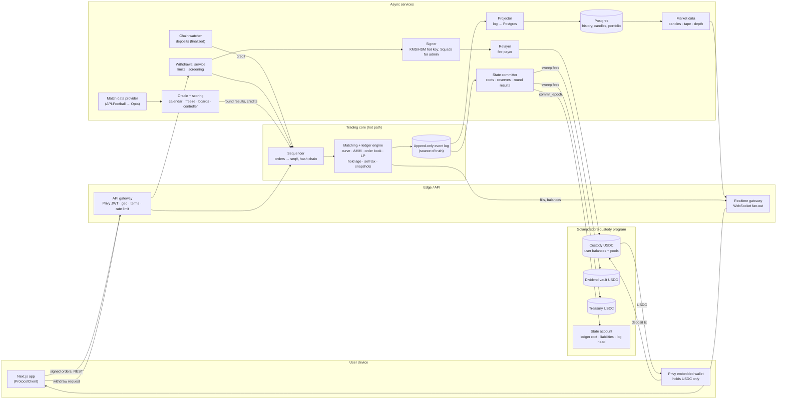
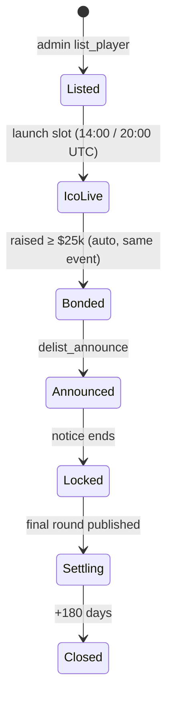
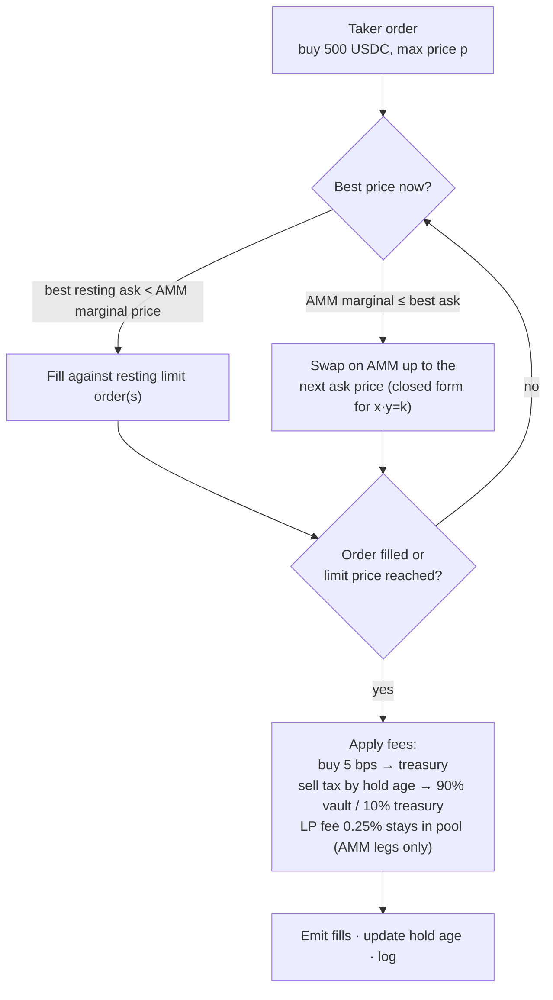
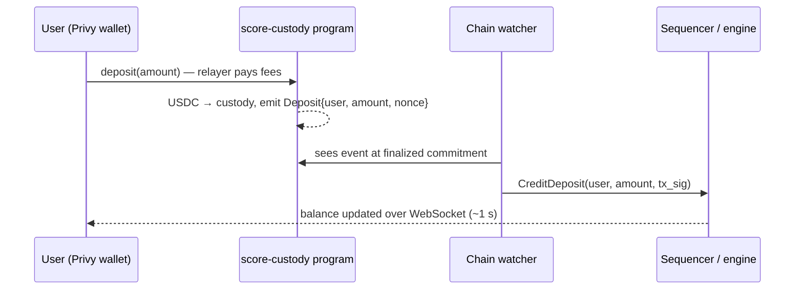
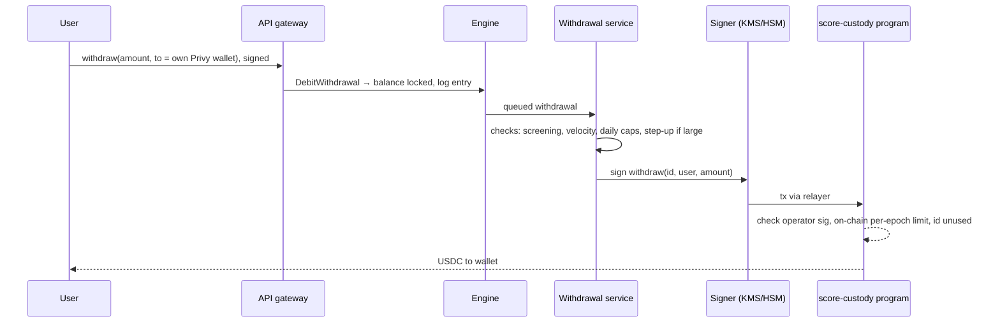
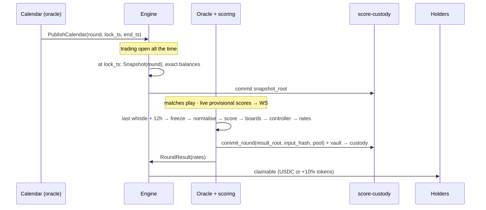

# score: contracts + backend architecture (proposal, draft 1)

> **Status: for review. Nothing here is built yet.** It is based on the Developer Specification v3.0 (`docs/concept/scorespecification.pdf`, 28 Oct 2026) and the client's latest direction (chat, 3 Nov): *own off-chain trading engine, no Meteora or third-party LPs, everything in-house, maximum control and security, familiar mechanisms (trading, indicators, order books, LP, AMMs).*
>
> Scope: Solana program + backend only. The frontend is unchanged: it keeps talking to the `ProtocolClient` seam (ARCHITECTURE §7.2), and a new `ApiProtocolClient` replaces the mock.

---

## 1. What changes from the spec

Spec v3.0 puts **everything on-chain**. One Anchor program holds USDC custody, the curve, the pools, LP, positions, lazy snapshots (`SnapBuf`), rates and claims. Every trade is a Solana transaction.

The client now wants **execution off-chain**. So the split becomes:

| Concern                                                    | Spec v3.0                              | This proposal                                                                                                                                   |
| ---------------------------------------------------------- | -------------------------------------- | ----------------------------------------------------------------------------------------------------------------------------------------------- |
| USDC custody, deposits, withdrawals                        | On-chain                               | **On-chain** (unchanged in spirit)                                                                                                              |
| Dividend vault + treasury                                  | Numbers inside the program             | **On-chain, as separate visible token accounts**                                                                                                |
| Curve, pool, LP, order book, positions, hold age, sell tax | On-chain program accounts              | **Off-chain engine** (our ledger)                                                                                                               |
| Kickoff snapshots                                          | Lazy `SnapBuf` (8 entries per account) | **Exact snapshot in the engine at lock time** (much simpler, no 8-change limit)                                                                 |
| Scoring, boards, controller, rates                         | Off-chain oracle → `publish_rate`      | Off-chain, same engine; **round result committed on-chain**                                                                                     |
| Claims (USDC or +10% tokens)                               | On-chain `claim` + `Claimed` PDA       | **Off-chain credit** to the in-app balance; USDC leaves only on withdrawal                                                                      |
| Trust                                                      | "The program enforces all rules"       | **The operator executes, the chain verifies.** Signed orders, a hash-chained trade log, ledger roots and proof of reserves posted on-chain (§5) |

What stays exactly as the spec says: every number and formula (curve, 70/20/10, fees, sell tax, hold age, LP shares, boards, controller, +10% election), **integer-only maths with protocol-favouring rounding**, player tokens as ledger entries (no SPL mint, which matches "no Meteora"), Privy embedded wallets that only ever hold USDC, no SOL for users, and geo/terms checks.

**Plain-language consequence:** the model becomes an exchange with on-chain custody and public proofs (Hyperliquid-style or "validium-lite"), not a pure DeFi protocol. We get speed, no sniping/MEV, near-zero chain cost per trade, and order books. We give up "trustless": users trust the operator's execution, and §5 makes that trust checkable. Legal counsel should know this. Custody of user funds by the team is a bigger regulatory question than a non-custodial program.

---

## 2. System overview

**One rule:** every state change goes through the sequencer and lands in the event log first. That includes trades, deposits credited, withdrawals debited, dividend credits and admin actions. Postgres, candles and the UI are projections of that log and can be rebuilt from it.

---

## 3. The off-chain engine (how trading works)

### 3.1 Shape

- **Deterministic state machine.** `state' = apply(state, event)`. No clocks, randomness or I/O inside `apply`. Time comes from the sequencer's timestamp on each event. Replaying the log rebuilds the exact state, which is what makes audits, hot standby and crash recovery work.
- **In-memory, single writer per market.** Each player is a market. One thread owns a set of markets, so there are no locks on the hot path. A cross-market action (a user's USDC balance) goes through a small account shard. A simpler v1 is one thread for everything: at our volume (hundreds of markets, thousands of users) one core does well over 100k ops/sec.
- **Integer maths from the spec.** u64 micro-USDC and base units, u128 intermediates, `fee = ceil(…)`, rounding toward the protocol. Today's `packages/core` uses JS floats and is fine for the mock, but not for money. Port `score_math/lib.rs` (spec §0) as one Rust crate, and compile it to WASM for the frontend's quotes, so a quote and a fill can never disagree.

### 3.2 Market phases per player

- **IcoLive:** buys and sells against the quadratic curve only. 1.25% fee, 240k-token cap per buy and per account. No order book (curve price is deterministic).
- **Bonded:** the engine creates the pool atomically in the bonding event: 70% seed + ~1.6M tokens, protocol shares locked, 20% to the vault bucket, 10% to treasury. Trading opens with AMM + order book.

### 3.3 AMM + order book together (hybrid liquidity)

The client wants both. The clean way is **one matching engine where the AMM is a built-in maker**:

- A taker always gets the better of the book and the pool, step by step. For a constant-product pool, the amount that moves the price to a target is closed form, so routing is exact and cheap.
- **Sell tax follows the seller, not the venue.** A seller pays their hold-age tax whether they fill against the pool or against a resting bid. A maker who sells via a resting ask pays it on fill. This keeps the core economics intact and makes the order book safe to add.
- Resting orders lock the user's USDC or tokens in the ledger. Order types for v1: limit (GTC, post-only), market with slippage cap. Stop/TP later.
- Maker rebate (spec: 2 bps, Deferred) can be switched on later from the treasury.
- **Order book is optional for v1.** AMM-only is less work and already beats the spec's on-chain version on speed. The order book can launch on the top 20 players first. **(Decision for the client.)**

### 3.4 Snapshots, dividends, claims (much simpler off-chain)

- At `lock_ts` (first kickoff) the sequencer injects a `Snapshot(round)` event. The engine records, for every bonded player, every user's position amount + LP token side (pool token reserve × LP shares ÷ total shares), excluding the protocol seed. Trading continues and nothing pauses.
- That snapshot is the exact `circulating_base` the spec's oracle needed. The `SnapBuf` workaround, its 8-change limit and the "claim within ~8 changes" caveat all go away.
- The snapshot's Merkle root is committed on-chain (§5), so anyone can check their kickoff balance was recorded.
- After the freeze, the oracle runs the scoring engine, boards and controller, then injects `RoundResult(round, rates, input_hash)`. Each holder gets a **claimable** entry. *Claim USDC* moves it to their in-app USDC balance. *Claim tokens* mints `amount × 1.10 ÷ price` from the player's reserve into their position (blended hold age), and the USDC stays in the vault.
- Optional: auto-claim as USDC after N days, so nothing gets stranded.

### 3.5 Hold age, caps and anti-abuse

- Hold age = weighted entry timestamp on the position (spec §6). It carries through LP add/remove and token elections exactly as specified.
- Account caps attach to the Privy user id (spec §16), not the wallet address.
- No MEV or sniping in the chain sense, since orders never hit a public mempool. The remaining risk is the **operator** reordering orders, which the signed-order + hash-chain design in §5 makes detectable.

---

## 4. Money in and out (the on-chain part)

### 4.1 Deposit

- Credit at **finalized** to rule out rollbacks. Since Alpenglow (mainnet, 21 Oct 2026) finalized arrives together with confirmed: 0.79 s median after sending, measured on devnet (the old ≈13 s figure is obsolete). ~~Optionally at **confirmed** (≈0.5 s), up to a small per-user limit, for a snappier first buy.~~ (superseded)
- Idempotent on `tx_sig`, so a deposit can never be credited twice.

### 4.2 Withdrawal

- **On-chain limits** live in the program, so even a stolen hot key can only drain up to the epoch limit (e.g. X% of custody per hour) before the multisig pauses it.
- Withdrawals only go to the user's registered wallet (v1). That blocks the usual account-takeover drain path.

### 4.3 The program: small on purpose

One program, `score-custody`. It is tiny because it never sees a trade:

| Instruction                                                               | Signer                        | What it does                                                                                                     |
| ------------------------------------------------------------------------- | ----------------------------- | ---------------------------------------------------------------------------------------------------------------- |
| `init`                                                                    | admin (Squads)                | Config, custody / vault / treasury token accounts (PDAs), keys, limits                                           |
| `deposit(amount)`                                                         | user (+ relayer as fee payer) | USDC → custody, emits event                                                                                      |
| `withdraw(id, user, amount)`                                              | operator hot key              | custody → user, within the epoch limit; `id` marked used (bitmap, no per-withdrawal account)                     |
| `commit_epoch(epoch, ledger_root, liabilities, log_head)`                 | operator                      | Stores roots; **fails if custody < liabilities** (proof of reserves, spec invariant I1)                          |
| `sweep(to_vault, to_treasury)`                                            | operator                      | Moves net fees from custody to the vault and treasury accounts, bounded by what the committed epoch says is owed |
| `commit_round(round, snapshot_root, result_root, input_hash, pool_micro)` | oracle                        | Round audit record; funds move vault → custody for that round's payouts (bounded by the controller's cap)        |
| `withdraw_treasury(amount)`                                               | admin multisig                | Treasury only                                                                                                    |
| `set_limits`, `set_paused`, `rotate_keys`                                 | admin multisig (timelocked)   | Ops                                                                                                              |
| `emergency_exit(proof)` *(Proposed)*                                      | user                          | If no `commit_epoch` for N days: withdraw your USDC balance from the last root with a Merkle proof               |

**Cost:** users pay nothing (relayer). The protocol pays roughly 1 tx per deposit, 1 per withdrawal, plus 1 commit every few minutes and 1 per round. That's cents per day, against thousands of dollars a day if every trade were on-chain. No per-user or per-position accounts, so no rent.

**Program tech:** Anchor for speed of development and audits, or **Pinocchio** for the smallest compute and binary. Recommendation: Anchor first (the reference program is Anchor), measure, then move only hot instructions if needed. The program is small enough that this choice barely matters for cost.

---

## 5. Trust: making the off-chain part checkable

This is how "maximum control" stays compatible with "users can verify we're honest":

1. **Signed orders.** Each order carries an ed25519 signature from the user's embedded wallet (Privy signs silently, no popup). The operator cannot invent trades or withdrawals for a user.
2. **Hash-chained log.** Each event gets `seq#` and `h_n = sha256(h_{n-1} ‖ event)`. The head is committed on-chain every epoch, so history can't be rewritten after the fact.
3. **Ledger root + proof of reserves.** Each epoch commits a Merkle root of all balances (USDC + positions + LP + claimable). The program checks custody ≥ total USDC liabilities. Users fetch their own proof from the API ("Verify my balance").
4. **Round audit.** Snapshot root, scoring input hash, engine version and result root go on-chain. The bundle goes to Arweave/IPFS so anyone can recompute (spec §14).
5. **Escape hatch (Proposed).** If the operator stops committing, users exit with their last proven USDC balance. Positions in players are harder: they're only worth something with a running market. Option: on shutdown, freeze at the last committed pool prices and redeem pro rata, like the spec's delisting flow. This is the most complex item and can come after v1.

Keys: admin = Squads 3-of-5 hardware (spec §15). Operator hot key in KMS/HSM, scoped by on-chain limits. Oracle key separate.

---

## 6. Round lifecycle end to end

Live provisional scores come from the same scoring library on a polling loop over the feed. They're display only (spec §5).

---

## 7. Backend: services and speed

| Service                       | Tech (proposed)                                                                                     | Notes                                                                                      |
| ----------------------------- | --------------------------------------------------------------------------------------------------- | ------------------------------------------------------------------------------------------ |
| Engine + sequencer            | **Rust**, single process, tokio for I/O, engine loop on a pinned thread                             | Target p99 < 5 ms order-to-ack in-region. Hot standby replays the log and takes over       |
| Event log                     | Append-only file with batched fsync (or Redpanda/Kafka later)                                       | Source of truth; periodic engine-state snapshots for fast restart                          |
| Projector + Postgres          | Rust or TS worker → Postgres                                                                        | Trade history, candles (1m→1d), portfolio, P&L, points                                     |
| API gateway                   | Rust (axum) or TS (Hono/Fastify)                                                                    | Privy JWT, geo (edge IP + sign-in attestation), terms version, rate limits                 |
| Realtime                      | WebSocket gateway, Redis/NATS pub-sub                                                               | Channels: market ticks, book deltas, trades, user fills/balances, round phase, live scores |
| Oracle + scoring              | Port the scoring engine to the shared Rust crate (or keep TS `packages/core`, switched to integers) | Calendar, freeze timer, provider ingestion, controller state                               |
| Chain watcher                 | Helius webhooks / Yellowstone gRPC                                                                  | Deposits at finalized; reconciles custody balance against the ledger every minute          |
| Withdrawal + signer + relayer | Rust/TS + cloud KMS                                                                                 | Queue, risk checks, Privy policies, fee payer                                              |
| Indicators                    | Client-side from candles (MA, EMA, BB, RSI already in Pro view)                                     | Server provides clean OHLCV + volume, which also fixes ARCHITECTURE's "no real volume" gap |

**Why Rust for the engine:** one maths crate shared with the on-chain program and (via WASM) the frontend, predictable latency, no GC pauses. A TypeScript engine on Bun would be fine at hackathon scale too, but it means maintaining the money maths twice. **(Decision: Rust core vs TS-first.)**

Hosting: one region close to users (EU, e.g. Frankfurt/London), engine on a dedicated VM (not serverless), managed Postgres, Next.js stays on Vercel.

---

## 8. Build order (proposed, after sign-off)

1. **Maths crate** (`score-math`): port the spec's integer maths + its 24 tests + invariants I1–I10. WASM build for the app.
2. **Engine v1**: curve, bonding, AMM, LP, hold age, sell tax, snapshot, rounds, claims. Event log + replay test. Uses fake deposits.
3. **API + realtime +** `ApiProtocolClient`: the UI moves off the mock without UI changes.
4. **score-custody program** on devnet: deposit, withdraw with limits, commit_epoch, sweep, commit_round. Chain watcher + withdrawal service + relayer. Privy.
5. **Oracle**: calendar, API-Football ingestion, freeze, scoring, controller, round commit.
6. **Order book** on top of the AMM (if approved for v1).
7. **Proofs UI** ("verify my balance"), escape hatch, audit prep, load test.

---

## 9. Questions to settle before building

1. **Custody model OK?** Execution and ledger off-chain, USDC custody on-chain with proofs. This is operator-trust (exchange-like), unlike spec v3.0. Does the client accept that, and has counsel seen it?
2. **Order book in v1,** or AMM-only first with the book on top players later?
3. **Reference code:** the spec names `score-programs/` (`score_math/lib.rs`, `engine.py`, the Anchor program, sims). It isn't in this repo. Can we get it? It saves re-deriving every rounding rule.
4. **Rust engine** (shared maths everywhere), or a TypeScript engine first?
5. **Commit cadence** for ledger roots (every 1 min / 10 min / hourly) and the **hot-wallet limit** for withdrawals.
6. **Escape hatch:** v1, later, or USDC-only?
7. **Deposits credited at confirmed** (fast, small limit) or only finalized?
8. **Withdrawals only to the user's own Privy wallet,** or to any address (with screening)?
9. **Claims:** keep the explicit "Claim" moment (good UX, spec's pull model), and auto-claim after N days?
10. **Sell tax on maker fills** (my recommendation: yes, it follows the seller). Confirm.

