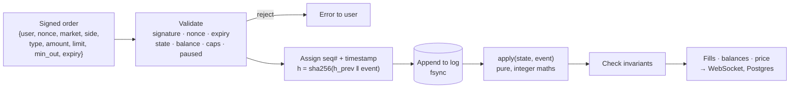

# score: the trading engine, explained (companion to BACKEND_ARCHITECTURE.md)

> **Status: for review.** This answers four questions on draft 1: what the LP is, whether x·y=k is good enough, how the engine works (with the maths), and how our instructions differ from the spec's. Every number below comes from the spec's formulas (`docs/concept/scorespecification.pdf`, v3.0). I ran them with floats for illustration; the real engine uses the spec's integer rounding. Nothing is built.

---

## 1. What is "the LP", where does it live, and why off-chain?

### 1.1 Short answer

**The pool (the "LP" that tokens migrate to after bonding) is a record in our engine, not an on-chain account.** Each player's pool record holds two numbers:

```
Market[HAALAND].pool = { usdc_reserve: Y, token_reserve: X, total_shares, protocol_shares }
```

The **USDC behind Y physically sits in the single on-chain custody account**, mixed with everyone else's USDC. Custody is one USDC token account. The engine knows how much of it belongs to each bucket: user balances, curve raises, pool reserves, vault, treasury and claimable.

The **player tokens (X) aren't on-chain at all.** They're numbers in the engine.

### 1.2 This is less different from the spec than it sounds

The spec (§3) already does this:

- *"Positions are ledger entries … There is no SPL token mint for players."*
- *"One USDC token account … holds everything: curve proceeds, pool reserves, the dividend vault, the treasury and unclaimed claims. The program tracks each bucket as a number."*

So even in the spec, the pool isn't a real Solana pool with its own token vaults. It's two `u64` fields inside a `Market` PDA, and the USDC sits in shared custody.

| | Spec v3.0 | Ours |
|---|---|---|
| Where the pool's numbers (Y, X, shares) live | `Market` PDA on-chain | Engine record (memory + event log + Postgres) |
| Where the pool's USDC physically is | Shared custody token account | **Same** shared custody token account |
| Where player tokens live | `Position` PDA (a number) | Engine record (a number) |
| Who updates the numbers | The program, one tx per trade | The engine, one log event per trade |
| How you prove the numbers are right | Read the accounts on-chain | Merkle root + log hash committed on-chain, custody ≥ liabilities checked by the program |

**The only thing that moves off-chain is where the bookkeeping happens.** The money's location doesn't change.

### 1.3 How the bonding curve runs off-chain

Same formula, same integer maths. The only difference is the source of the USDC:

1. The user has **deposited** USDC once. Their custody balance is, say, $200 in the engine.
2. They tap "Buy $50 of HAALAND". The app signs an order message with the Privy wallet (no transaction, no popup).
3. The engine applies the spec's `buy_curve` maths (§3.2 below). It debits their engine USDC balance, raises `Market.raised`, credits their `Position`, and credits `treasury` with the fee.
4. No USDC moves on-chain. It's already in custody, and only the labels change.

When `raised ≥ $25,000`, the same event that crosses the threshold also runs `graduate`. There's no separate step that someone has to call.

### 1.4 Why off-chain (and what the options really are)

What prompted it was the client's direction in the chat: "run our trading engine off-chain", "smoother and faster buys and sells", "sniping", "program costs", "maximum control". Concretely, on-chain the spec costs us:

- **One Solana tx per trade, paid by our relayer.** The spec also has the relayer pay rent for every `Position`, `LpPosition` and `Claimed` account, about 0.002 SOL each. With 200 players and thousands of users, that's tens of thousands of accounts.
- **Speed.** A trade waits about 0.4 to 1 s to land. Any order book would need far more compute than a Solana tx allows.
- **Snapshot workaround.** `SnapBuf` keeps only 8 snapshots per account, so "users must claim within roughly 8 balance changes" (spec §9.3). Off-chain we keep an exact snapshot of every holder at kickoff.
- **Launch sniping.** Bots can land `buy_curve` in the launch slot via priority fees or Jito bundles. Off-chain, everyone is in one queue that we control.

This is still the main decision. There are three real options:

| Option | Trades | Custody | Speed / cost | Trust |
|---|---|---|---|---|
| **A. Spec v3.0** | On-chain program | On-chain | ~1 s, 1 tx + rent per action | Trustless: the program enforces everything |
| **B. Draft 1 (this)** | Off-chain engine | On-chain custody + proofs | ~ms, almost free | Operator executes; chain verifies roots and reserves |
| **C. Mix** | Off-chain engine matches | On-chain batch settlement: the engine posts net balance changes every N seconds and the program checks invariants per batch | ~ms to fill, final every N s; cost per batch | Between A and B; much more program work |

My recommendation is still **B**, with C as a later upgrade path if the client wants stronger guarantees. Both use the same engine.

---

## 2. Is x·y=k too simple?

### 2.1 Who uses what

| Venue | Model |
|---|---|
| Uniswap v2, Raydium CPMM, PumpSwap, Meteora DAMM v1/v2 | **Constant product (x·y=k)** |
| Uniswap v3/v4, Orca Whirlpools, Raydium CLMM | Concentrated liquidity (x·y=k in price ranges) |
| Meteora DLMM, Trader Joe LB | Discrete price bins |
| Curve | StableSwap (for pegged assets) |
| DODO, Lifinity | Oracle-anchored market maker |
| **Off-chain engines: Binance, Hyperliquid, Polymarket** | **Central limit order book.** Liquidity comes from market makers, not a curve |

**Venues with off-chain engines almost never use AMMs.** AMMs were invented because on-chain you can't run an order book cheaply and you have no market makers. Off-chain those constraints disappear.

### 2.2 So why keep an AMM at all?

Because our problem isn't "no compute", it's **no market makers**:

- 200+ thin markets, none of which a professional market maker will quote 24/7.
- The spec's 70% seed ($17,500 per player) is protocol-owned, permanent liquidity. A pool is the natural way to make that money always quote.
- A price must always exist for the sell tax, the +10% token election (`price_micro`), LP dividends and delisting redemptions.
- The spec's economics (seed price continuous with the curve, LP shares, IL, LP token side for dividends) were all designed around constant product, and the client wants "familiar mechanisms". Users understand "a pool, plus limit orders".

### 2.3 Is constant product robust enough?

**Mathematically, yes.** It's the most battle-tested AMM:

- Liquidity at every price; the pool can never be emptied (x and y only approach 0).
- With fees kept in the pool, k only rises (spec invariant I2). LPs and the locked seed get deeper over time.
- No oracle needed. That matters here: there's no external "true price" of a Haaland token.
- Small integer maths, easy to verify and audit.

**Practically, the weakness is depth.** Liquidity is spread from $0 to infinity, so most of it sits at prices nobody trades. On the opening pool ($17,500 + 1.6M tokens, price $0.01094):

| Buy | Tokens | Average price | Price after | Impact |
|---|---|---|---|---|
| $100 | 9,063 | $0.011034 | $0.011064 | +1.1% |
| $1,000 | 86,232 | $0.011597 | $0.012222 | +11.7% |
| $5,000 | 354,688 | $0.014097 | $0.018068 | +65% |

For a consumer app where most tickets are $10 to $200, that's fine. For whales, it's steep, which also limits pump-and-dump around kickoff (a feature here).

### 2.4 Ways to add depth, ranked

1. **Constant product + limit order book (draft 1, §3.3).** Users and the protocol can rest orders near the price. This adds depth exactly where people trade, without changing the pool maths. *Recommended.*
2. **Dynamic LP fee.** Higher during live windows (spec §7 proposes 0.75%) or after big moves. This protects LPs from adverse flow. Cheap to add.
3. **Concentrated liquidity (v3-style) for the protocol seed only.** The protocol puts the $17.5k in a range, say 0.3× to 3× of the current price. That gives about 3 to 4× the depth for the same money, but the seed then needs re-ranging if the price leaves the range. Retail LPs stay on full range. *Later, after real data.*
4. **Virtual reserves (pump.fun style).** These fake extra depth, but the pool can run out of real tokens or USDC at extremes. *Not recommended* for a pool that must always back redemptions.

**Bottom line:** x·y=k is the right base layer, not a placeholder. Keep the spec's maths, put an order book on top, and tune fees. Concentrated seed liquidity is the upgrade if data shows depth is the problem.

---

## 3. The engine, opened up

### 3.1 What it stores

All amounts are integers: micro-USDC and base units (1 token = 10⁶), per spec §2. Below I write them as $ and whole tokens to keep the examples readable.

```
Account(user)              usdc_free, usdc_locked (in open orders / pending withdrawal), nonce
Position(user, player)     amount, locked (in open asks), entry_ts, cap_bought
LpPosition(user, player)   shares, entry_ts
Market(player)             state, sold, raised, pool{Y, X, total_shares, protocol_shares},
                           reserve_left, book{bids, asks}
Buckets (global)           vault, treasury, claimable
Rounds                     calendar{round, lock_ts, end_ts}, snapshot[round], results[round]
```

**Conservation rule, checked after every event** (spec invariant I1 restated):

```
custody USDC on-chain  ≥  Σ usdc_free + Σ usdc_locked + Σ raised (IcoLive) + Σ Y (Bonded)
                         + claimable + (vault and treasury not yet swept)
```

Every trade only **moves numbers between these buckets**. Real USDC moves on-chain in only three cases: deposit (wallet → custody), withdraw (custody → wallet), and sweep (custody → vault/treasury token accounts).

### 3.2 The loop



`apply` is a pure function: same log in, same state out, byte for byte. That's what lets a standby replica, an auditor or a user's own verifier replay it.

### 3.3 Bonding curve (state `IcoLive`)

Spec §5, with S = whole tokens sold:

```
price(S)      = 0.00039 + S² / 3.883e15
cost(S, d)    = 0.00039·d + ((S+d)³ − S³) / 1.1649e16          (USDC to buy d tokens from S)
refund(S, d)  = cost(S−d, d)                                    (USDC for selling d tokens back)
```

**Buy** with `usdc_in`:

```
net     = usdc_in × 10000 / 10125              (leave room for the 1.25% fee)
tokens  = largest d with cost(sold, d) ≤ net   (binary search, ~45 steps)
require tokens ≥ min_tokens
require tokens ≤ 240,000 and cap_bought + tokens ≤ 240,000
cost    = cost(sold, tokens);  fee = ceil(cost × 1.25%)
user.usdc −= cost + fee;  raised += cost;  treasury += fee
sold += tokens;  position += tokens;  cap_bought += tokens;  entry_ts blended (§3.7)
```

| Example | |
|---|---|
| First buyer, $50 at S=0 | net $49.38, fee $0.62, **126,180 tokens**, average $0.000391 |
| $500 at S=3,000,000 (price $0.002708) | 173,607 tokens, average $0.002845, price after $0.002984 |
| The 240k cap at S=0 | costs only ~$96, so the cap binds on early buyers, not on spend |

**Sell** `d` tokens: `refund = cost(sold−d, d)`, `fee = ceil(refund × 1.25%)` (90% to vault, 10% to treasury), and the user gets `refund − fee`. `sold −= d`, `raised −= refund`, `cap_bought −= d`. Selling the 126,180 tokens straight back returns $48.77, so a buy followed by a sell always loses the fees (invariant I8).

### 3.4 Graduation (automatic, inside the event that crosses $25k)

```
seed     = raised × 70%      → pool Y            ($17,500)
vault   += raised × 20%                           ($5,000)
treasury+= raised − seed − vault                  ($2,500)
X        = seed / price(sold)                     (1,599,828 tokens at S_max = 6,400,040)
require sold + X ≤ 8,000,000                      (7,999,868 ✓)
total_shares = protocol_shares = seed            (shares counted in micro-USDC of seed)
reserve_left = 10M − sold − X  (≈ 2M)          state = Bonded
```

The pool opens at $0.010939, the curve's last price, so there's no jump at graduation. The spec's partial fill applies: the crossing buy fills only up to $25k and the excess is refunded.

### 3.5 Constant-product pool (state `Bonded`)

The spec's swap primitive, with an LP fee `f` of 0.25%:

```
swap(r_in, r_out, a):   lp_fee = a × f;  net = a − lp_fee
                        out = net × r_out / (r_in + net)
                        r_in += a  (the full amount, so the fee stays and k grows);  r_out −= out
spot price  P = Y / X
```

**Buy** with `usdc_in`: `buy_fee = ceil(usdc_in × 0.05%)` goes to treasury, then `tokens = swap(Y, X, usdc_in − buy_fee)`.
Example ($1,000 on the opening pool): buy fee $0.50, LP fee $2.50, **86,232 tokens**, price $0.010939 → $0.012222.

**Sell** `d` tokens: `gross = swap(X, Y, d)`, then `tax = ceil(gross × tax_bps(age))`. The tax splits 90% vault, 10% treasury, and the user gets `gross − tax`.

```
tax_bps(age) = 500 − 450 × min(age, 90 days) / 90 days      (5.00% → 0.50%)
```

Example: 50,000 tokens held 7 days → gross $529.07, tax 4.65% = $24.60 ($22.14 vault, $2.46 treasury), **payout $504.47**.

**How much USDC moves the price to a target P′?** k is constant apart from fees, so `Y′ = √(k·P′)` and the USDC needed is `√(k·P′) − Y`, grossed up for fees. On the opening pool, a +5% move needs about $433. The router (§3.6) uses this closed form.

### 3.6 Order book on top: the router

Resting orders hold the price level and quantity. A resting **ask** locks the seller's tokens; a resting **bid** locks USDC. A taker order is filled in steps, always from the cheapest source:

```
while order not filled and price within limit:
    p_amm  = current pool marginal price
    p_book = best resting ask (for a buy)
    if p_book < p_amm:   fill against the ask, up to its size
    else:                swap on the pool only until its price reaches p_book (closed form above)
```

**Worked example:** a $1,000 buy, with one resting ask for 50,000 tokens at $0.0112. After the 5 bps buy fee, $999.50 is routed.

| Leg | Venue | USDC | Tokens | Price after |
|---|---|---|---|---|
| 1 | Pool, until its price reaches $0.0112 | $208.06 | 18,751 | $0.011200 |
| 2 | Ask at $0.0112 | $560.00 | 50,000 | ask used up |
| 3 | Pool, the rest | $231.44 | 20,347 | $0.011494 |
| | **Total** | $999.50 | **89,098** (AMM-only: 86,232, +3.3%) | |

**The maker is a seller, so they pay their sell tax on their $560** (it follows the seller, not the venue). LP fee applies only to the pool legs. Maker fee 0; the maker rebate is deferred in the spec.

### 3.7 Hold age

```
on receiving q tokens at time now:   entry_ts = (entry_ts × amount + now × q) / (amount + q)
on selling:                          entry_ts unchanged
age = now − entry_ts
```

Example: 10,000 tokens bought 60 days ago + 10,000 today → age 30 days → sell tax 3.5%.
Tokens coming back from an LP withdrawal blend in at the **LP position's** entry time, so pooling can't reset the tax.

### 3.8 Liquidity

```
add (usdc_max, tokens_max):  shares = min(usdc_max × total / Y,  tokens_max × total / X)
                             take usdc = ceil(shares × Y / total), tokens = ceil(shares × X / total)
remove (shares):             usdc = Y × shares / total, tokens = X × shares / total   (floor)
                             require total − shares ≥ protocol_shares
USDC-only "zap":             one order = swap about half, then add
```

Example: on the opening pool, $1,000 + 91,419 tokens → 1,000 shares (of 18,500). Later the pool is Y = $20,000, X = 1.5M → remove gives $1,081.08 + 81,081 tokens.

### 3.9 Snapshot, dividends, claims

At `lock_ts`, the sequencer inserts a `Snapshot(round)` event. Trading keeps going. For each bonded player:

```
held(user)       = position.amount + position.locked
lp_side(user)    = X × lp.shares / total_shares            (protocol shares excluded)
circulating      = Σ held + Σ lp_side
```

The engine stores the result and commits a Merkle root of it on-chain.

After the freeze, the oracle sends `RoundResult(round, payout per player)`:

```
rate      = payout / circulating
amount    = (held + lp_side) × rate          → claimable for that user, for that player and round
```

Example (spec's board example): Haaland pays $672.43, 7.5M tokens circulating at kickoff, a user held 75,000 (1%) → **$6.72**.

**Claim USDC:** `claimable −= amount`, `usdc_free += amount`. The user withdraws whenever they like.
**Claim tokens:** `tokens = amount × 1.10 / price`. If the price is $0.0135, that's 547.9 tokens, minted from `reserve_left`. The $6.72 goes back to the vault, and the position is credited with a blended entry time. If the reserve is too low, it fails and the user claims USDC instead (spec §13).

---

## 4. Instructions: spec vs ours

### 4.1 Mapping

| Spec instruction / account | Ours | Where |
|---|---|---|
| `init_config` | `init` | **On-chain** |
| `set_paused` | `set_paused` (deposits, withdrawals) + engine `Pause` event (trading) | Both |
| `list_player` | `ListPlayer` admin event (signed by the multisig key) | Engine |
| `publish_calendar` | `PublishCalendar` oracle event; included in the round commit | Engine (+ on-chain record) |
| `buy_curve`, `sell_curve` | Orders on an `IcoLive` market | Engine |
| `graduate` | Automatic, in the crossing event | Engine |
| `swap_buy`, `swap_sell` | Orders on a `Bonded` market (pool + book router) | Engine |
| `add_liquidity`, `remove_liquidity` | Orders | Engine |
| *(none)* | `place_limit`, `cancel` | Engine (new) |
| `publish_rate` (one tx per player per round) | `RoundResult` engine event + **one** `commit_round` with a Merkle root of all rates | Engine + on-chain |
| `claim`, `claim_lp` | `Claim` order (USDC or tokens) | Engine |
| `withdraw_treasury` | `withdraw_treasury` | **On-chain** (unchanged) |
| *(none)* | `deposit`, `withdraw`, `commit_epoch`, `sweep`, `set_limits`, `rotate_keys`, `emergency_exit` | **On-chain** (new) |
| Accounts `Config`, custody authority | Same | On-chain |
| `Calendar`, `Market`, `Position`, `LpPosition`, `RoundRate`, `Claimed` | Engine records (in the ledger root) | Engine |
| `SnapBuf` (8 per account) | Exact snapshot per round | Engine |
| *(none)* | `State` account: ledger root, liabilities, log head; `RoundCommit` | On-chain (new) |

The spec's "common accounts for user trades" list (`user`, `payer`, `user_usdc`, `custody`, `custody_auth`, `config`, `market`, `position`, `cal`, token and system programs) now applies **only to `deposit` and `withdraw`**. A trade isn't a transaction any more. It's a signed message to our API.

### 4.2 The same buy, both ways

**Spec (on-chain):**

```
App builds tx: buy_curve(player_id, usdc_in, min_tokens)
  accounts: user, relayer, user_usdc, custody, custody_auth, config, market, position, cal, token, system
Privy signs → relayer signs as fee payer → sent to Solana → ~0.4–1 s
Program: checks, binary search, snapshot record, USDC transfer wallet → custody, update Market + Position
```

**Ours:**

```
(Once) deposit tx: wallet → custody. Credited at finalized.
App signs message: {user, nonce: 42, market: HAALAND, side: buy, type: market, usdc: 50, min_out: 125,000, expiry}
POST /orders → engine validates signature + nonce → same maths → fill → WebSocket in a few ms
No tx. Every few minutes commit_epoch puts the new ledger root and log head on-chain.
```

### 4.3 What each side has to trust

| Risk | Spec | Ours |
|---|---|---|
| Operator invents a trade for a user | Impossible | Impossible: needs the user's signature |
| Operator reorders or front-runs | Validators/searchers can | Operator could, but the hash-chained log and the timestamps make it detectable |
| Operator miscomputes a fill | Impossible | Detectable: anyone can replay the public log with the open-source `apply` |
| Operator steals custody | Impossible | Limited by the on-chain withdrawal cap per epoch, the multisig and the reserves check; the escape hatch is the backstop |
| Operator goes offline | Program keeps running | Trading stops; escape hatch returns USDC from the last root |

---

## 5. Questions added by this doc

1. **Option A, B or C (§1.4)?** B is the draft. C makes settlement trustless at the cost of much more program work.
2. **Constant product + book for v1,** concentrated seed liquidity later. Agree?
3. **Publish the event log** (anonymised user ids) so anyone can replay it? This is what makes "detectable" real.
4. **Protocol limit orders:** should the treasury rest orders near the price to add depth (a protocol market maker)? It adds depth but puts treasury money at risk.
