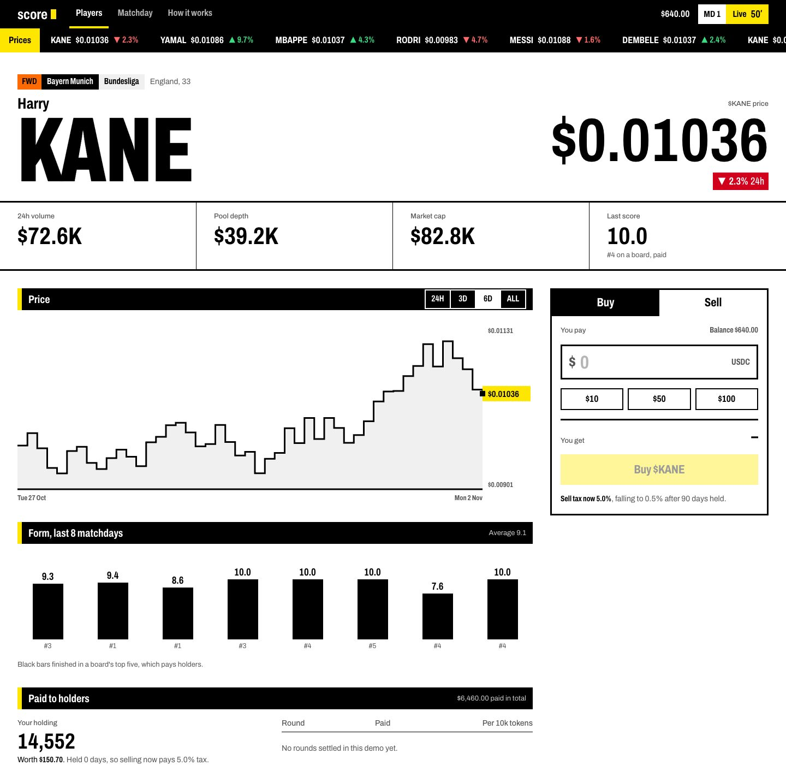
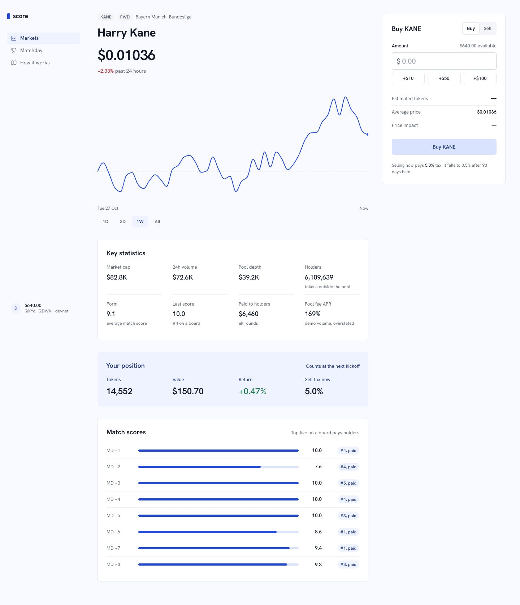
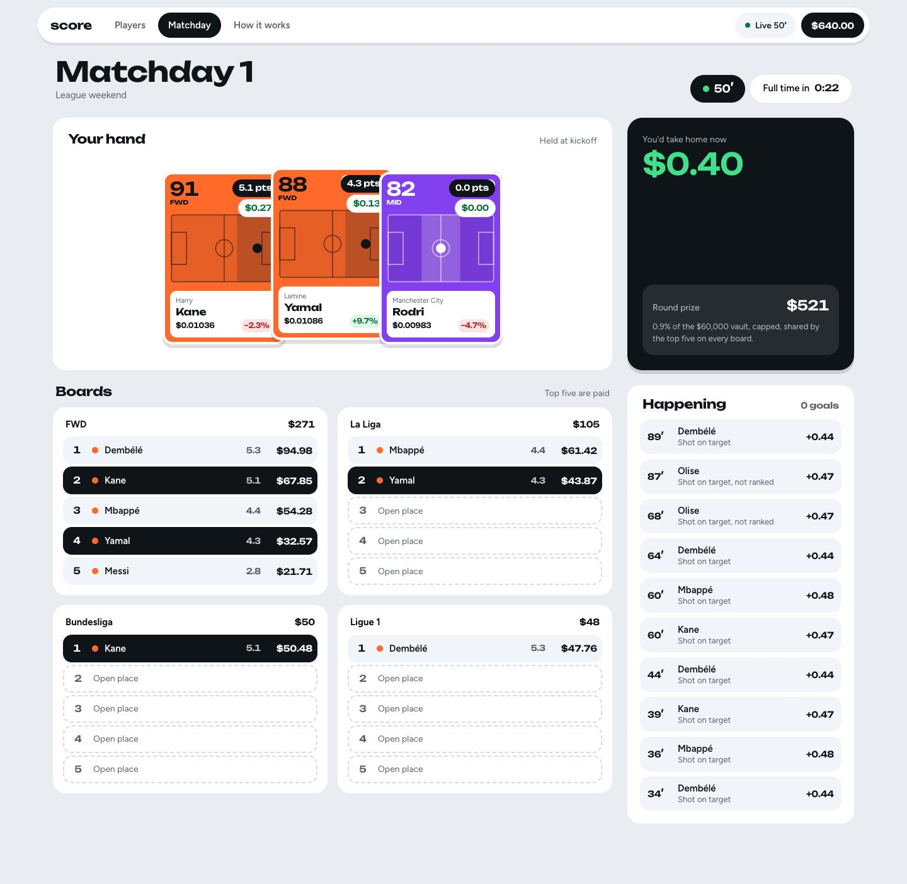
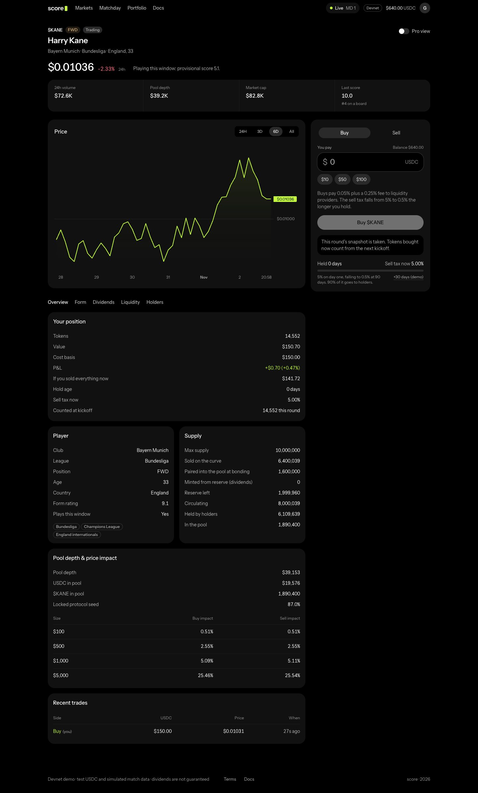

# Design directions (Step 1.5)

Four different designs of the same three screens: the player hub in its trading state (with the trade panel), the live matchday, and the landing hero with its first fold. Each is built at desktop (1440) and mobile (375).

**See them live:** run `bun run dev` and open `/lab`. The bar at the bottom of every lab screen switches direction and screen. Its moment buttons pin the shared mock world at one instant:
- **Mid-match:** live, 55% through the window, with KANE, YAMAL and RODRI held at kickoff.
- **Before kickoff.**
- **Full time.**

Every direction then shows the same data. `/lab` exists only under `next dev`: its route files are `page.dev.tsx`, so production builds contain no lab route and no lab code.

**Screenshots** (all taken on the pinned mid-match moment with `scripts/lab-shots.mjs`):
- `docs/screenshots/lab/<direction>/<screen>-<desktop|mobile>.jpg`: full pages.
- `docs/screenshots/lab/compare-<screen>-<desktop|mobile>.jpg`: one side-by-side image per screen.
- axe (WCAG 2 AA, serious and critical) reports no violations on any of the 24 screens.

**How they were made:**
- **Research:** in `docs/INSPIRATION.md`.
- **Lead aesthetic skill:** each direction has one (see `docs/UI_SKILLS.md`).
- **Shared code:** directions share only the data hooks, `packages/core`, the formatters, the `ProtocolClient`, and the headless trade-ticket logic in `src/directions/lab/`, so they are compared on design, not behaviour. Tokens, components and libraries are each direction's own (`src/directions/<id>/`).
- **Direction D:** the dark build already on the production routes (see the 2026-11-03 entry in `DECISIONS.md`).

Bundle figures below are each direction's own libraries, measured (minified with `bun build`, then gzipped), plus each typeface's latin woff2 file. The shared base is React, TanStack Query and the mock client, and it is left out.

---

## A · Broadcast

**Idea:** score as the matchday TV graphics package. The scorebug, lower thirds, stat bars and a price crawl along the top.
**Inspired by:** FotMob's live score block and Sofascore's live counts; TV sports graphics; Football Index's price ticker.
**Lead skill:** frontend-design (one memorable element, the type as the graphic, quiet everything else).
**Libraries:**
- **GSAP:** the crawl's continuous marquee, the landing's single headline wipe, and pause on hover or focus.
- **d3-shape:** a hand-drawn stepped SVG chart; prices move in trades, so steps rather than curves.
- No component library.

**Palette:**
- **Ground and ink:** white paper, pure black ink and bars.
- **Brand:** broadcast yellow `#ffe600` as the one brand colour, always with black text.
- **Positions as solid blocks:** GK pink `#ff3ea5`, DEF blue `#0057ff`, MID violet `#7a3cff`, FWD orange `#ff6a00`.
- **Money:** green `#00843d` and red `#d1001c` only on money, always with ▲/▼.

**Type:**
- Archivo, a single family with a width axis.
- Condensed 62% heavy uppercase for player names only.
- Semi-condensed bold tabular figures.
- Normal width for reading.

**Key components:**
- The scorebug (matchday · live · minute).
- The lower-third player header (first name, huge surname, huge price).
- The stat-bar strip, black heading bars with a yellow edge, and position blocks.
- League-table boards with numbered black rank cells and "open place" rows.
- Wipe-in event banners (goals inverted to black).
- The price crawl.

**Motion personality:** broadcast. Event banners wipe in from the left (clip-path, 420ms). The crawl runs continuously and stops on hover. The landing headline wipes in once. Under reduced motion all of it stops.

**Bundle:** 30 KB gzipped JS (GSAP 27 + d3-shape 3) · 90 KB font (Archivo variable, latin).

**Strengths:**
- Says "football" from across a room.
- The biggest numbers of the four: the price, the minute and your earnings read on a projector, which suits a Breakpoint stage demo.
- The crawl makes the market feel alive on every screen.

**Weaknesses:**
- Loud; long sessions on the player hub can tire.
- Uppercase names and black bars give it a betting-site edge if pushed further.
- Square, heavy forms need discipline on dense screens (portfolio, docs).

**Suits:** fans who come for the matchday, and a live stage demo.

## B · Clean fintech

**Idea:** a calm brokerage. The price is the page title, the chart is the hero, and one blue does all the marking.
**Inspired by:** Robinhood's stock page (price as title, scrub-to-read chart, key-statistics grid); Polymarket's ticket (preset chips, one button); Kalshi's quiet type.
**Lead skill:** design-taste-frontend, app style `accent-ladder` (light, seed 370616198).

Two values were redrawn for stated reasons:
- **Hue:** blue instead of the dealt raspberry, which sits too close to the loss red.
- **Typeface:** Hanken Grotesk instead of the dealt DM Sans, whose Google build has no tabular figures (measured).

**Libraries:**
- **visx:** shape, scale, curve and event, for the scrubbable line chart. Scrubbing moves the headline price.
- **NumberFlow:** the price and earnings figures roll digit by digit when they change.
- Radix is not needed on these screens.

**Palette:**
- **Ground and sheets:** a blue-white ground `#f8faff` and white sheets with hairlines `#e4e8f0`.
- **Accent:** blue `#2148d6` only on small marks (the button, the data series, the active nav icon); its pale tints `#eef3ff` / `#d9e3fd` carry the areas.
- **Positions:** neutral grey pills, so the screen keeps one hue family.
- **Money:** green `#1f7a4d` and red `#c4242a`.

**Type:** Hanken Grotesk, one family, tabular by default. 32px bold titles, a 40px price, 14px body.

**Key components:**
- **Shell:** an open-plane sidebar shell; on phones, a 48px bar and a menu sheet.
- **Charts and figures:** the scrub chart with range chips, the key-statistics grid, and the one tinted card per screen (your position, your provisional earnings).
- **Matchday and trading:** the window progress track, quiet board tables, and an order ticket with presets and fee rows.

**Motion personality:** almost none, on purpose. Digits roll when a figure changes, and the chart follows the pointer. Nothing enters or bounces.

**Bundle:** 21 KB gzipped JS (visx + NumberFlow) · 35 KB font.

**Strengths:**
- The most trustworthy with money.
- The easiest to extend to every route (portfolio, docs and terms fall out of it naturally).
- Fastest to read, and the lightest bundle.
- Scrubbing the price is a strong "feels like a real broker" moment.

**Weaknesses:**
- The least memorable; nothing in it says football or score.
- At Breakpoint it will look like many good fintech dApps.
- The matchday lacks energy; it reads as a report.

**Suits:** investors and traders who care about the money first, and due diligence.

## C · Collectible

**Idea:** every player is a card you collect; on matchday your hand of cards plays.
**Inspired by:** Sorare's cards as objects, FPL's shirt tiles, FotMob's player attributes, Sport.fun's market panels; Polymarket's ticket for the money part.
**Lead skill:** frontend-design (the card is the one bold element; the table around it stays quiet).

**Libraries:**
- **Motion:** card tilt toward the pointer, the card flip, the hand dealing in, board rows that slide when ranks change (layout animations), and event stickers that spring in.
- **Recharts:** the price area in the player's own colour, and the form bars on the card back.

**Palette:**
- **The table:** cool grey `#e9edf2`, with white panels `#ffffff` and ink `#0f1419`.
- **Card faces, vivid, in position colours:** GK sunflower `#ffc531`, DEF blue `#2a63f0`, MID purple `#8240ee`, FWD orange `#ff6a2b`.
- **Money:** green `#0b7139` and red `#b4202a` on pale chips.

**Type:** Unbounded (wide display, for names, ratings and prices on the cards) with Figtree for reading.

**Key components:**
- **The player card:** a typographic picture with no photo.
  - A form rating (×10) in the corner, like collectible football cards.
  - Position and ticker.
  - A pitch drawing with the player's zone lit.
  - A white name band with price and change.
- **The player hub:** a card flip (form chart and finishes on the back), and a market panel with metric tiles.
- **The matchday:**
  - Your hand: fanned cards wearing live points and earnings.
  - A black prize card with your take-home figure.
  - Boards as rounded rows, with your players inverted.
  - Event stickers in the player's colour for goals.
- **Controls:** chunky pill buttons that sink when pressed.

**Motion personality:** playful but brief. Springs on the cards and stickers, one dealing moment on load, rows that slide to their new rank. All of it is off under reduced motion.

**Bundle:** 173 KB gzipped JS (Motion 51, Recharts 122) · 71 KB fonts (Unbounded 51 + Figtree 20). Recharts is most of the weight. Its two small charts could be redrawn in plain SVG or visx (about 15 KB), which would bring C to roughly 65 KB.

**Strengths:**
- **Your stated preference:** the closest to light backgrounds with coloured elements.
- **A no-photo identity:** the card answers "no photos, crests or logos" with a real picture of each player.
- **The demo moment:** the matchday "hand" is the strongest of the four.
- **Clearly not a crypto terminal:** good for a consumer DeFi product at Breakpoint, next to Sport.fun's and Sorare's worlds without copying either.

**Weaknesses:**
- **Heaviest bundle,** as shipped.
- **Money tone:** gamey can undercut seriousness on fees and taxes, so the ticket and portfolio must stay plain.
- **Dense lists:** cards don't suit them (markets, portfolio); those screens need a compact row form of the card.

**Suits:** fans and collectors new to on-chain trading, and the consumer story.

## D · Night terminal (dark wildcard)

**Idea:** the dark build already on the production routes. True black, elevation by lightness, lime only on data, and the matchday strip as its signature.
**Inspired by:** Hyperliquid and Jupiter density, the founder's terminal prototype, and FotMob's live minute.
**Lead skill:** design-taste-frontend, app style `true-black-flat` (dealt earlier in Step 1, before the four-direction exploration; see `DECISIONS.md`).

**Libraries:**
- **shadcn/ui on Radix:** every control.
- **Lightweight Charts:** candles and areas, and the Pro view indicators.
- **CSS transitions** only.

**Palette:**
- **Grounds by lightness:** `#000` → `#111` → `#2a2a2a`.
- **Text:** white and two greys.
- **Lime `#c6ff3d`:** on gains, live state and bonding progress only; red `#ff6b81` on losses.

**Type:** Instrument Sans, with tabular figures; Geist Mono only for addresses.

**Key components:** the matchday strip (snapshot → live → freeze, every kickoff marked), the Pro view, the split-stage landing with a live board, and every route and state already built.

**Motion personality:** feedback only. Price flashes, count-ups on payouts, the strip's moving "now".

**Bundle:** 71 KB gzipped JS (Lightweight Charts) on top of the shared shadcn/Radix base · 57 KB font.

**Strengths:**
- Complete today, across all routes, states and both widths.
- The densest, which traders like.
- The Pro view.

**Weaknesses:**
- **Against the brief:** dark, against the stated preference for light.
- **Generic:** near-black with a single acid-green accent is the look frontend-design names as a generated-design default, and the look of most Solana trading apps (Jupiter, Hyperliquid, Meteora). It is the least distinctive at Breakpoint.

**Suits:** active traders in long sessions.

---

## Side by side

| | A Broadcast | B Clean fintech | C Collectible | D Night terminal |
|---|---|---|---|---|
| Ground | White | Blue-white | Cool grey + white panels | True black |
| Colour carries | Yellow + position blocks | One blue, as tints | Card faces by position | Lime on data |
| Type | Archivo condensed | Hanken Grotesk | Unbounded + Figtree | Instrument Sans |
| Shape | Square, heavy rules | 8px cards, hairlines | 20–24px, sticker shadows | 16px, no borders |
| Chart | Stepped black line | Scrub line, no grid | Area in card colour | Lightweight Charts |
| Motion | Wipes, crawl (GSAP) | Digit roll (NumberFlow) | Springs, flips, reorders (Motion) | CSS flashes |
| Density | Medium–high | Sparse | Medium–low | High |
| JS weight | 30 KB | 21 KB | 173 KB (≈65 KB without Recharts) | 71 KB |

## Recommendation: C · Collectible, with B's money discipline

**C** is the one I'd build out:
- **It matches your stated preference:** a light ground with the colour on the objects.
- **It turns the hardest constraint into the identity:** with no photos, crests or logos, the card gives every player a face of their own (position colour, rating, pitch zone).
- **It has the best demo moment:** your hand of cards lighting up as they score.
- **It stands apart at Breakpoint:** most Solana products there look like D.

Two borrowings would keep it serious where money moves:
- **From B:** the trade ticket's plainness (fee rows, one primary action, the tax line before every sell) and a compact table form of the card for markets and portfolio lists.
- **From A:** the big live minute on matchday.

Before the build-out, C's two Recharts charts should be redrawn in SVG or visx to drop about 108 KB.

If you'd rather lead with trust over personality, B is the safe alternative. A is the bold one for a stage. D stays available as a "night mode" reference.

**🛑 Waiting for your choice:** one direction, or a mix (for example "C, with B's ticket and A's matchday clock"). It will be recorded in `DECISIONS.md`, then 1.6 writes the design system for it.
