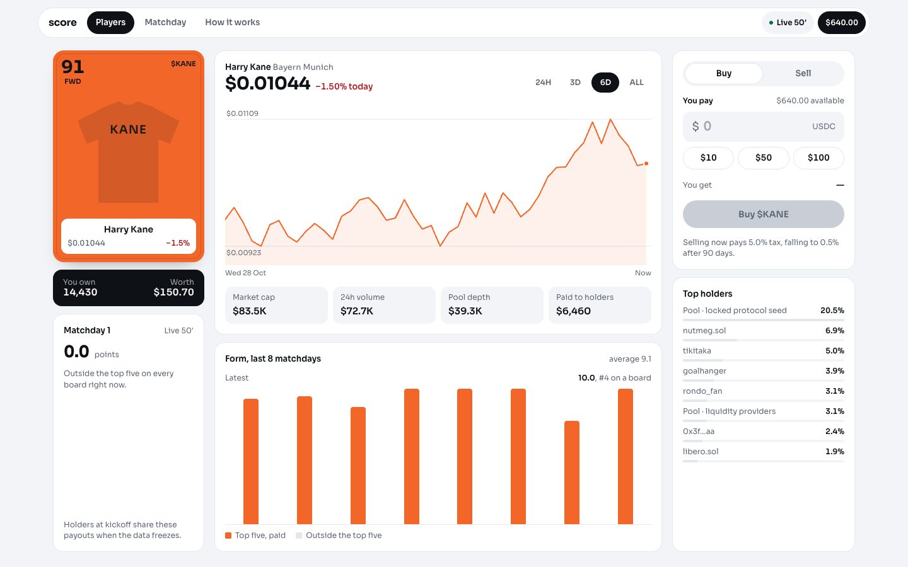

# Design directions (Step 1.5)

**Status (3 Nov, after the first review):** A (Broadcast) and B (Clean fintech) were dropped; they live in git history (commit `ff6f1a7`, screenshots included). C and D were revised against the review notes and stay in play.

**See them live:** run `bun run dev` and open `/lab`. The bar at the bottom switches direction and screen, and its moment buttons pin the shared mock world at one instant (mid-match with KANE, YAMAL and RODRI held, before kickoff, or payout, with dividends waiting), so both directions show the same data. Direction D is the production routes; C lives in `src/directions/c-collectible/`. `/lab` exists only under `next dev`.

**Screenshots** (pinned mid-match, `scripts/lab-shots.mjs`): `docs/screenshots/lab/<direction>/<screen>-<desktop|mobile>.jpg`, and one side-by-side image per screen, `docs/screenshots/lab/compare-<screen>-<desktop|mobile>.jpg`. axe (WCAG 2 AA, serious and critical) reports no violations on any of the 12 screens.

**Research limit for round two:** the session's permission policy refused browser captures of new references (gacha.game, pump.fun and other .fun sites) as bot-check circumvention, and gacha.game renders client-side only, so the revisions draw on the existing captures in `docs/INSPIRATION.md` and the design skills. Screenshots dropped into `docs/` can be used directly.

---

## C · Collectible (revised)

**Idea:** every player is a card you collect; on matchday your hand of cards plays.
**Lead skill:** frontend-design. Motion checked against better-ui (`animations.md`, `performance.md`) and improve-animations (`AUDIT.md`).

**What changed after review**

| Note | Change |
|---|---|
| Cards look generated | New card: flat position colour with a fine inner keyline, a soft object shadow (no white frame, no hard sticker shadow), form rating and position top-left, ticker top-right, the **back of a generic shirt with the surname printed across the shoulders** as the picture (no photo, crest or kit), and a compact white plate with name, price and change. |
| Font looks squashed | Unbounded + Figtree replaced by one minimal geometric family, **Sora** (normal width, default tracking; tabular digits 27.0px, punctuation 10.5px). |
| Hover and flip not smooth | **Flip:** was an exit-then-enter swap (`AnimatePresence mode="wait"`) that paused at 90°; now one element with two faces and a single CSS `transform` transition (520ms, strong ease-in-out, interruptible), cross-fade under reduced motion. **Tilt:** was JS springs on Motion's shorthands (main thread); now written straight to `transform` in a `requestAnimationFrame`, smoothed by a 220ms ease-out transition, mouse and fine pointers only, off under reduced motion. **Hover lift** in the fanned hands: a CSS transition behind `(hover: hover) and (pointer: fine)`. Board reorders keep Motion's layout animation (transform-based), under `MotionConfig reducedMotion="user"`. |
| Too big, too long | Body 14px, headline figures 22–30px, panels 16px radius with hairlines, 12–16px gaps. Each screen now fits about one desktop screen; the landing is one hero panel plus one strip. |
| Half the screen empty (round three) | On desktop the screens fill the window's height with content: the player's columns run to the bottom (card + this matchday, market with a chart that grows into the space, ticket + top holders); the landing hero stretches and its card fan scales with it. |

**Palette:** ground `#f2f4f7`, white panels, ink `#0e1116`. Card faces: GK `#f5b82e`, DEF `#2a63f0`, MID `#7c45e8`, FWD `#f2662a`. Money: `#0b7139` / `#b4202a` (contrast measured in `tokens.css`).
**Libraries:** Motion (board reorders only). Recharts removed: the price area and form bars are hand-drawn SVG.
**Bundle:** 51 KB gzipped JS (Motion) · 34 KB font (Sora). Was 173 KB + 71 KB.
**Strengths:** light with colour on the objects (your stated preference); the card answers "no photos" with a football picture; the matchday hand is the demo moment; clearly not a crypto terminal.
**Weaknesses:** the card is decorative on dense lists (markets, portfolio) and needs a compact row form there; screens are now small, so the build-out must keep 44px touch targets (the ticket's chips grow to 44px on phones).

## D · Night terminal (revised; the production routes)

**Idea:** true black, elevation by lightness, lime only on data; the matchday strip as the signature.
**Lead skill:** design-taste-frontend (`true-black-flat`).

**What changed after review**

| Note | Change |
|---|---|
| Ticker and price unnoticeable | The ticker is a white chip at the top of the header. The price is 44px in the new figure face, coloured by its 24h move (lime up, pink down), with the change in a tinted pill beside it. |
| Toast too high, blends in | Desktop offset 24px (the 84px offset was meant for the phone's tab bar and is now phone-only at 76px). Toasts sit on the raised surface `#2a2a2a` with a float shadow, so they read above the cards. |
| Stats too small | Market cap, 24h volume, pool depth or raised, and last score now 24px figures with 12px labels in the softer grey; market cap leads. |
| Account menu reads like machine text | Rebuilt: avatar, "Your devnet wallet", "Signed in with Google, Germany"; the balance as the biggest thing in the menu; actions with icons and verbs (Add 1,000 test USDC, Copy address with the short address, Portfolio, Demo settings, Sign out). The same action keeps one name everywhere. |
| Number font | **Funnel Sans** for figures (`.fig` and numeric table cells), chosen from an in-context comparison of eight faces; Instrument Sans stays for text, Geist Mono for addresses. Rejected: Azeret Mono (point takes a digit's width), Chivo (too wide and heavy beside the labels). |
| Header and menu (round three) | The USDC coin mark replaces the "USDC" text; a generated avatar per wallet replaces the initial; the menu opens on your address (tap to copy) with Devnet/Google chips, then the balance with dollars large and cents quiet, and two pill actions. |
| Landing too long | Two screens: headline, line, button and three real figures beside the live board; then how it works in four short steps. The landing uses the same header as the app now. |

**Libraries:** shadcn/ui on Radix, Lightweight Charts, CSS transitions.
**Bundle:** 71 KB gzipped JS (Lightweight Charts) plus boring-avatars (a few KB) on the shared shadcn/Radix base · fonts: Instrument Sans 57 KB, Funnel Sans, Geist Mono.
**Inspector (taste):** markets, matchday and portfolio 0 FAIL / 0 WARN; player 0 FAIL / 1 WARN (tab detail below the fold, by design). Landing: 2 FAIL / 1 WARN left, all from the page rules that want a longer, richer page (≥4 pictures, more scroll motion, a video). They contradict the review's "shorter and more minimal" and the no-photos rule, so the review wins.
**Strengths:** complete across every route, state and width; dense; Pro view.
**Weaknesses:** dark, against the stated light preference; near-black with one acid accent is the common look of Solana trading apps.

---

## Side by side

| | C Collectible | D Night terminal |
|---|---|---|
| Ground | Cool grey + white panels | True black |
| Colour carries | Card faces by position | Lime on data, price by direction |
| Type | Sora | Instrument Sans + Funnel Sans figures |
| Shape | 16px panels, hairlines | 16px surfaces, no borders |
| Chart | Hand-drawn SVG in the card's colour | Lightweight Charts |
| Motion | Card flip, tilt, hand lift, board reorders | Price flashes, count-ups |
| JS weight | 51 KB | 71 KB |

## Recommendation

C, if light and consumer-first is the goal: it now has the minimal frame you asked for, and the card is the identity. D, if you'd rather ship the dark terminal that already covers every route. Either way the next step is 1.6 (the design system for the chosen one) and 1.7 (every route in it).

**🛑 Waiting for your choice:** C, D, or a mix (for example C's cards on D's routes in a light theme).
