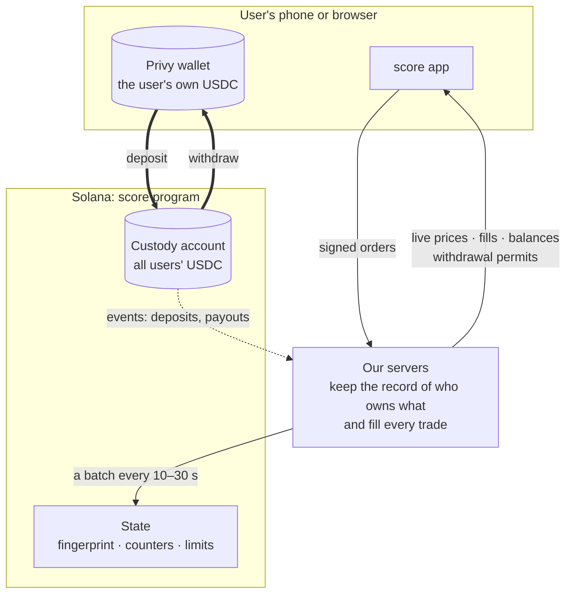
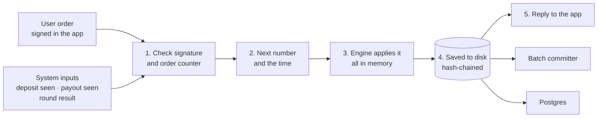
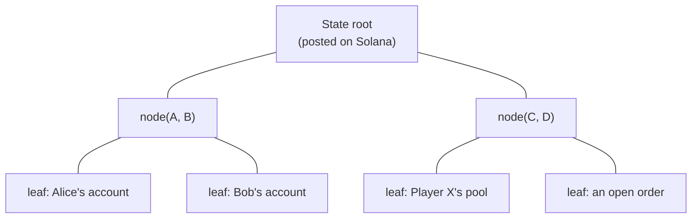
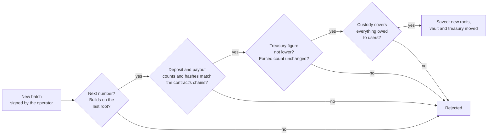
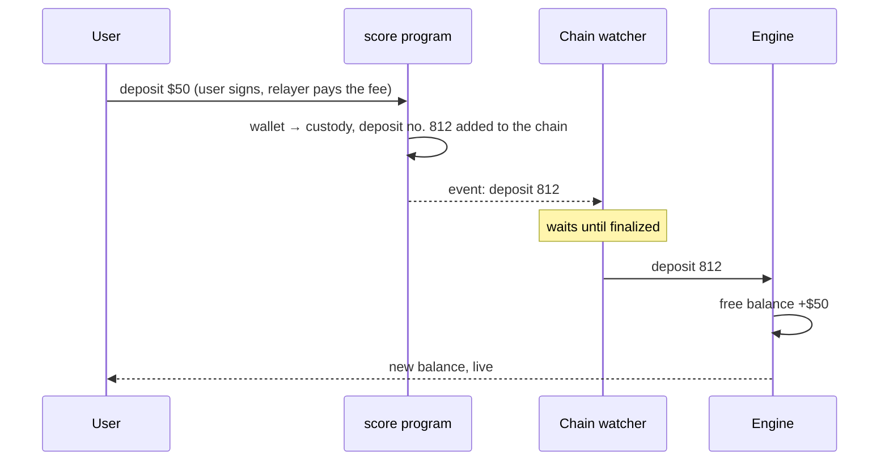
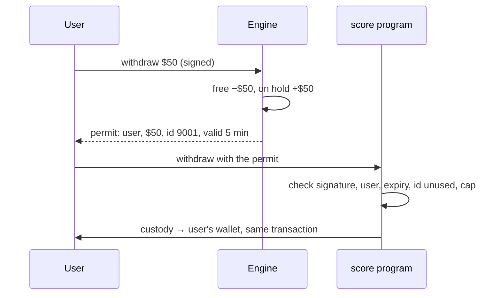
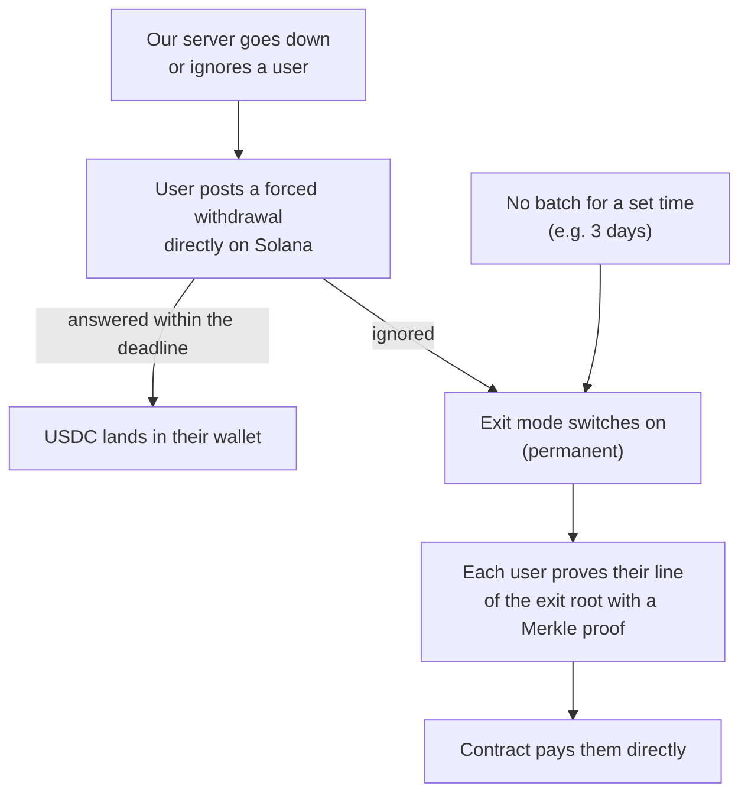

# How the score backend works

Trading is fast because it runs on our server. Users' money is safe because it stays in a Solana contract that checks our server's work every 10 to 30 seconds.

- **Off-chain (our server):** every buy, sell, order and payout is worked out here. The engine fills an order in about 31 µs, and users pay no gas.
- **On-chain (Solana contract):** all users' USDC sits here. Deposits and withdrawals go through it, and it checks the server's work.
- **The link between them:** every 10 to 30 seconds the server posts a short "fingerprint" of every balance to the contract. Nobody can quietly change a balance after that, and users can take their money out even if our server disappears.

Users get the speed of an exchange app without having to trust us with their money.

**How to read this doc.** Sections 1–2 are the plain-language overview. Sections 3–4 go deep on the maths and on how the state is hashed and verified. Every formula in them is taken from the code. Each deep section starts with an "In plain words" line, so you can skim the formulas and still follow.

---

## 1. The big picture

### 1.1 The three parts



- **Money moves only between the user's wallet and the custody account,** in Solana transactions the user signs.
- **Orders never touch Solana.** They go from the app to our servers and are filled there.
- **Our servers report to the contract every 10–30 seconds,** and the contract checks that report against the money it holds.

### 1.2 What runs where

| Piece | What it does | Where |
| --- | --- | --- |
| **score app** | The screens. Signs each order with the user's wallet key (no popup) | Vercel |
| **Privy wallet** | The user's own wallet. Holds only USDC; users never need SOL | User's device |
| **API + live updates** | Takes orders in; streams prices, fills and balances out | Our server |
| **Sequencer** | Checks each order's signature, gives it the next number and the time, puts it in one line | Our server |
| **Engine** | Applies each action: curve, pools, order book, liquidity, fees, sell tax, rounds, claims | Our server (in memory) |
| **Log** | Saves every action to disk before we say "done". Replaying it rebuilds everything exactly | Our server's disk |
| **Permit signer** | Signs a withdrawal permit once the engine has put the amount on hold | Our server (hardware vault on mainnet) |
| **Relayer** | Pays the Solana fee on users' deposits and withdrawals, so users never need SOL | Our server |
| **Chain watcher** | Reads the contract's events, only once they're finalized | Our server |
| **Batch committer** | Every 10–30 s, computes the fingerprints and posts them to the contract | Our server (a second copy replaying the log) |
| **Postgres** | Trade history, charts, portfolio. Not on the trading path | Neon |
| **score program** | Holds the USDC, enforces the rules for money in and out, checks each batch | Solana |

**One rule holds it all together:** every change (trades, deposits, withdrawals, dividends, admin changes) goes through the sequencer and lands in the log first. Balances, charts and fingerprints are all rebuilt from the log. If anything disagrees with the log, the log wins.

---

## 2. What happens to one order



The engine's rules:
1. **All or nothing.** An action either fully happens or not at all. A failed order changes nothing.
2. **Every user order carries the user's signature,** stored in the log. We can't invent or alter anyone's trade.
3. **Same log in, same result out.** No randomness, no clock reads, no decimals. Anyone who replays the log gets the same balances, down to the last micro-cent. This is what makes the whole system checkable.
4. **Save before saying yes.** The reply goes out only once the action is on disk. Many actions share one disk write, which keeps this fast.

---

## 3. The maths

**In plain words:** every price, fee and payout is computed with whole numbers only, never decimals. Every time a division leaves a remainder, we choose which way to round so the pool or protocol never pays out money it doesn't have. Getting this right took research into Uniswap v3's pool maths, fixed-point arithmetic and bonding curves, plus a lot of testing against exact results.

### 3.1 The number system

| Thing | Unit | Why |
| --- | --- | --- |
| USDC | micro-USDC (1 USDC = 1,000,000) | Matches USDC's 6 decimals on Solana |
| Player tokens | base units (1 token = 1,000,000) | Same precision as USDC |
| Curve maths | milli-tokens (1 token = 1,000) | Keeps cubes inside 128-bit numbers |
| Pool prices | square root of price, in Q64.64 | Uniswap v3's representation; exact and fast |
| Order book prices | USD per token × 10⁹ | Fine-grained limit prices |

- **All arithmetic is checked 128-bit integer maths.** Any overflow is an error, never a silent wrap.
- **Multiply-then-divide uses 256-bit intermediates,** so `a × b / d` never loses precision before dividing.
- **Square roots** use integer Newton iteration, which returns the exact floor of the root.

**Q64.64 fixed point** means a number stored as an integer scaled by 2⁶⁴. A pool's price is stored as:

```text
sqrt_x64 = √(USDC per token) × 2^64
```

The allowed range is 2⁴⁰ to 2⁸⁸, which covers prices from about 3.6 × 10⁻¹⁵ to 2.8 × 10¹⁴ USD per token. The bounds are chosen so every intermediate value provably fits in 256 bits.

**The rounding rule, everywhere:**

| Case | Rounds | Effect |
| --- | --- | --- |
| Amounts the pool or protocol receives | Up | Users never underpay |
| Amounts the pool or protocol pays out | Down | Never pays a fraction it doesn't hold |
| Fees | Up | Protocol never under-collects |
| Liquidity credited for a deposit | Down | A depositor can't withdraw more than they put in |
| Next pool price after a trade | Moves less than the exact value | The pool always comes out slightly ahead |
| Dividend and exit splits | Down | Leftover fractions stay in the pot |

### 3.2 The bonding curve (ICO phase)

**In plain words:** before a player graduates, the price rises with the square of the tokens sold, so early buyers pay less. The cost of a purchase is the area under that price curve.

Price, with `s` = tokens sold in milli-tokens and `Q = 3,883,000,000`:

```text
price(s) = 390 + s² / (Q × 10^6)        micro-USDC per whole token
```

So the first token costs $0.00039, and the price climbs smoothly from there.

The cost of buying `Δ` milli-tokens from `s` is the exact integral of the price, computed with integers:

```text
cost(s, Δ) = ceil( [ 390 × Δ × 3Q × 10^6  +  (s + Δ)³ − s³ ]  /  (3Q × 10^9) )
refund(s, Δ) = floor( same formula from s − Δ )
```

- **Buying rounds the cost up, selling rounds the refund down,** so a buy-then-sell can never make money from rounding.
- **"How many tokens does $X buy?"** uses a binary search: the largest `Δ` whose cost is at most $X. It takes about 33 steps over the 8M-token float.
- **Limits:** 1.25% fee, 8M tokens for sale (of 10M), at most 240,000 tokens (3% of the float) per purchase and per account.

### 3.3 Graduation

**In plain words:** when a player's raise hits $25,000, the curve closes and a trading pool opens in the same order. The order still fills completely.

1. **Clip at exactly $25,000.** A second binary search finds the smallest amount of tokens whose cost reaches the threshold. That part of the order fills on the curve.
2. **Split the $25,000:** 70% seeds the pool (locked forever), 20% to the dividend vault, 10% to the treasury.
3. **Open the pool at the curve's closing price:**

```text
pool_tokens = seed_usdc / closing_price
opening sqrt price = √(seed_usdc × 2^128 / pool_tokens)
```

4. **Place the protocol seed as a fixed ladder** around the opening price p₀, so the pool has deep liquidity near the price and some everywhere:
   - 30% in [0.75 × p₀, 1.33 × p₀]
   - 30% in [0.4 × p₀, 2.5 × p₀]
   - about 40% across the full price range
5. **The rest of the order buys from the new pool** at its opening price, in the same action.

**A bug I found and fixed in the reference program:** a buy that overshot $25,000 by about $0.50 or more made the reference `graduate` instruction fail its own 8M-token check, so that player's market could never graduate. Here the curve part stops exactly at the threshold, so this can't happen.

### 3.4 The concentrated-liquidity pool

**In plain words:** after graduation each player has a pool that always has a price and always trades, like Uniswap v3 or Orca. Liquidity providers can put their money in a chosen price range, earn fees there, and withdraw any time. I ported Uniswap v3's maths to our integer format, keeping its rounding rules.

**Core formulas.** With L = liquidity and √a, √b the range's sqrt prices:

```text
tokens in a range:  Δx = L × (√b − √a) × 2^64 / (√a × √b)
USDC in a range:    Δy = L × (√b − √a) / 2^64
```

**How a trade moves the price:**

```text
USDC in (price rises):    √p' = √p + Δy × 2^64 / L                     rounded down
tokens in (price falls):  √p' = L × 2^64 × √p / (L × 2^64 + Δx × √p)   rounded up
```

Both round so the price moves slightly less than the exact value, which favours the pool.

**A swap, step by step:**
1. Find the next range boundary in the direction of the trade.
2. Swap within the current liquidity until the input runs out or the price hits that boundary (Uniswap v3's `computeSwapStep`, with the 0.25% fee charged on the input).
3. On crossing a boundary, add or remove that boundary's net liquidity, then continue.

Two changes from Uniswap v3:
- **Exact boundaries instead of ticks.** Ranges are keyed by their exact sqrt price, not a tick grid. A `just_below` flag handles a trade that stops exactly on a boundary.
- **Simulate, then apply.** A trade first runs on a copy of the pool. Only if it passes the slippage check is it applied. A rejected trade never leaves the pool half-changed.

**LP fee accounting** uses v3's fee growth per unit of liquidity:

```text
fee_growth   += fee × 2^64 / L              per swap step (Q64.64, wrapping)
fee_inside    = global − below(lower) − above(upper)
fee_owed      = floor( L_position × Δfee_inside / 2^64 )
```

Each boundary remembers the fee growth "outside" it and flips that value when crossed. That gives every position's earned fees exactly, in constant time, no matter how many traders or positions there are.

**The pool's balances are always enough to cover every position's principal plus earned fees.** This is checked after every action in the tests.

### 3.5 The router and order book

**In plain words:** every order is filled from whichever is cheaper at that moment, the pool or another user's limit order. Users always get the best price available.

1. **Price-time priority** in the order book: best price first, then earliest.
2. **Cheapest venue first.** The pool is swapped only until its price reaches the next resting order's price (or the taker's limit). Then that order is filled, and so on. At equal prices the book goes first.
3. **Plan, then commit.** The whole fill is planned read-only, checked against the user's slippage limit, then applied in one go.
4. **No trading with yourself.** If a taker would hit their own resting order, that order is cancelled and refunded.
5. **The book never crosses the pool:** the best bid is always at or below the pool price, and the best ask at or above it.

### 3.6 Fees and sell tax

```text
fee(amount, bps)  = ceil(amount × bps / 10,000)

sell tax (bps)    = 500 − 450 × min(age, 90 days) / 90 days
                    → 5% at first, falling to 0.5% after 90 days

holding age       = weighted entry time:
entry'            = (entry × old_tokens + now × new_tokens) / (old_tokens + new_tokens)

split of sell tax = 90% dividend vault, 10% treasury
```

- **The sell tax follows the seller everywhere,** to the pool or to another user, so the order book can't be used to dodge it.
- **Topping up doesn't reset your holding age:** new tokens are blended in by weight.
- **Moving tokens into or out of a liquidity position doesn't reset it either.**

| When | Charge | Goes to |
| --- | --- | --- |
| ICO buy | 1.25% | Treasury |
| ICO sell | 1.25% | 90% vault, 10% treasury |
| Graduation | The $25,000 raised | 70% pool (locked), 20% vault, 10% treasury |
| Buy after graduation | 0.05% | Treasury |
| Any pool trade | 0.25% LP fee | Stays in the pool for liquidity providers |
| Sell after graduation | 5% → 0.5% over 90 days | 90% vault, 10% treasury |

### 3.7 Dividends

- **The snapshot is exact:** at kickoff, every holder's tokens are counted, including tokens in sell orders and in liquidity positions.
- **Each holder's share = their tokens / all counted tokens × the player's dividend, rounded down.** Leftover fractions stay in the vault.
- **Claiming as tokens** gives 10% more, at the snapshot's pool price:

```text
tokens = dividend_usdc × 1.10 / price
```

### 3.8 How the maths is tested

- **Against exact fractions:** every fixed-point and pool formula is compared with exact big-integer results across hundreds of thousands of cases. Rounding must be exactly the floor or ceiling in the stated direction.
- **Pool fuzzing:** random ranges, swaps and withdrawals. The pool must always cover every position. Round trips never profit. Splitting a trade never beats one trade.
- **Engine fuzzing:** thousands of random sequences of every action. After each one, the full set of rules (section 4.7) must hold.
- **Mutation checks:** deliberately broken rounding, fee accounting and routing are each caught by the tests.
- **Totals:** 45 engine tests plus a 3,000-run random trading test, 22 contract tests, and an 18/18 end-to-end run on devnet.

---

## 4. State verification: how anyone can check us

**In plain words:** in a normal app, users trust the company's database. Here, every action is chained to the one before, the whole state is fingerprinted every batch, and the contract checks the fingerprint against the money it holds. The past can't be rewritten, and each user can prove what they're owed on their own.

### 4.1 The idea in one analogy

Think of the engine as a shop's ledger, and the contract as a notary.

Every 10 to 30 seconds, the shop hands the notary a sealed summary of the whole ledger. The notary checks that it follows the last summary, that it matches the notary's own receipts for cash in and out, and that the safe holds enough cash. Then it stamps and files it publicly. From then on:
- the shop can't rewrite the past, because the stamped summary would no longer match;
- any customer can prove what they're owed using the stamped summary, without the shop's help.

That sealed summary is a **batch commitment**. The rest of this section is how it's built.

### 4.2 Fingerprints (hashes)

A fingerprint, or *hash*, is a 32-byte code calculated from data. We use **SHA-256**, the same function Bitcoin uses.
- The same data always gives the same fingerprint.
- Changing even one digit anywhere gives a completely different fingerprint.
- Nobody can work backwards to fake data that matches a given fingerprint.

**Domain separation:** every kind of hash starts with its own fixed label, for example `score:log:v1:` or `score:deposit:v1:`. That means a hash made for one purpose can never be passed off as another.

### 4.3 Layer 1: user signatures on every order

Every user order is signed with the user's wallet key (Ed25519, Solana's own signature scheme):

```text
signature = ed25519_sign(user_key, "score:order:v1:" || borsh(order))
```

The signature is stored in the log with the order. Anyone replaying the log checks every signature, so the operator can't invent, change or replay a user's trade.

### 4.4 Layer 2: the hash-chained log

Every accepted action is chained to the one before it:

```text
h_n = SHA256( "score:log:v1:" || h_(n−1) || seq_n || timestamp_n || borsh(action_n) || borsh(signature_n) )
```

- Changing, removing or reordering any past action changes every hash after it.
- The latest hash (the **log head**) goes into every batch on Solana, so the log as of that batch is locked in.
- Replaying the log checks the sequence numbers, timestamps, signatures and every hash, and must reproduce the state exactly.

**On disk**, each record is framed as `length | CRC32 | record`. After a crash, a half-written last record is detected by its CRC and trimmed. Corruption anywhere else stops the server rather than guessing.

### 4.5 Layer 3: the state root (a Merkle tree of everything)

**What goes in.** One leaf per item of state, in a fixed order:

| Tag | What each leaf holds |
| --- | --- |
| `glob` | Global totals: custody, vault, treasury, counters, parameters |
| `acct` | Each user's free USDC, USDC on hold, USDC in orders |
| `hold` | Each user's tokens per player, with their holding age |
| `mrkt` | Each player market: ICO or trading, raised, sold |
| `pool` | Each pool's price, liquidity, fee growth, reserves |
| `bnd_` | Each pool range boundary: liquidity and fee data |
| `ordr` | Each open order |
| `lpos` | Each liquidity position |
| `lock` | Each withdrawal on hold |
| `cal_` `snap` `elpx` `clm_` `prnd` | Round calendar, kickoff snapshots, snapshot prices, dividend claims, rounds in progress |

**How it's hashed:**

```text
leaf = SHA256( 0x00 || tag || borsh(key) || borsh(value) )
node = SHA256( 0x01 || left_child || right_child )
```

1. Leaves are sorted by tag, then by key, so the same state always gives the same tree.
2. Pairs of leaves are hashed into nodes, pairs of nodes into higher nodes, up to one hash at the top: the **state root**.
3. An odd node out is carried up unchanged rather than duplicated.



**Why the `0x00` and `0x01` prefixes, and no duplication:** they make it impossible to pass a node off as a leaf, or to build two different trees with the same root. These are known weaknesses of naive Merkle trees, so I designed them out.

**Why a tree and not one big hash:** to prove one item, you need only that item plus one sibling hash per level (a **Merkle proof**). That's about 20 hashes for a million items. The contract can check it cheaply, and no one else's data is revealed.

### 4.6 Layer 4: the exit root

Next to the state root, each batch commits a second tree: **what each user would be paid if everything stopped right now.**

```text
exit_leaf = SHA256( 0x00 || "exit" || user || usdc || n || (lock_id, amount) × n )
```

Each user's `usdc` already includes:
- free USDC and USDC in buy orders;
- unclaimed dividends;
- the USDC side of their liquidity positions, plus earned fees;
- a fair share of each pool's USDC for the tokens they hold, with no sell tax;
- for ICO-stage players, a fair share of the curve's raised USDC.

Withdrawals on hold are listed separately with their permit ids, so the contract can tell whether each was already paid. Every share rounds down, so the table can never pay out more than custody holds.

### 4.7 Layer 5: the contract's own records of money in and out

The contract keeps its own hash chains of every deposit and every payout, independent of our server:

```text
deposit_hash_n = SHA256( "score:deposit:v1:" || deposit_hash_(n−1) || n || user || amount )
payout_hash_n  = SHA256( "score:payout:v1:"  || payout_hash_(n−1)  || n || kind || id || to || amount )
```

It also keeps the last 32 checkpoints of each chain, so a batch can point to any recent position on them.

The engine tracks the same numbers. In tests, this exact equality is checked after every single action:

```text
custody + vault + treasury USDC  =  free balances + on hold + in buy orders + ICO pots
                                  + pool USDC + unclaimed dividends + vault + treasury
```

### 4.8 What's in a batch

| Field | Meaning |
| --- | --- |
| `seq` | Batch number. Must be exactly the last one + 1 |
| `prev_state_root` | The root this batch builds on. Must equal the contract's current one |
| `state_root` | The new fingerprint of everything (4.5) |
| `exit_root` | The new exit table (4.6) |
| `log_head` | The latest log hash (4.4) |
| `deposits`, `deposit_hash` | How many on-chain deposits the engine has applied, and the deposit chain hash at that point |
| `payouts`, `payout_hash` | The same for payouts |
| `forced_served` | How many forced requests have been answered |
| `liabilities` | Everything the engine says it owes |
| `vault`, `treasury` | The engine's dividend vault and treasury figures |

### 4.9 What the contract checks before accepting a batch



1. **In order:** `seq = last + 1`, and `prev_state_root` equals the stored root. No batch can be skipped, replayed or forked.
2. **Deposits match:** the batch's deposit count is between the last batch's and the contract's current count, and its hash equals the contract's own chain at that count. The engine can't invent a deposit or skip one.
3. **Payouts match,** the same way. The engine can't hide a withdrawal. A pending treasury withdrawal must be included.
4. **Forced requests:** the count must equal the contract's own. Only the contract's `serve_forced` can mark a request answered, so a batch can't skip one.
5. **Treasury only grows in a batch.** Only the multisig's `withdraw_treasury` takes money out.
6. **The money is there.** After moving the vault and treasury change, custody, adjusted back to the batch's point in time, must cover everything owed to users:

```text
custody − to_vault − to_treasury + paid_since_cut − deposited_since_cut
    ≥  liabilities − vault − treasury
```

If every check passes, the contract saves the new roots and moves the vault and treasury difference since the last batch. A failed batch moves nothing, and the next one moves the larger difference.

### 4.10 What this means in practice

| If the operator tried to… | What stops it |
| --- | --- |
| Fake a trade for a user | No user signature; replay of the public log fails |
| Rewrite history | The log head and state root on Solana no longer match |
| Invent a deposit | The contract's deposit chain hash doesn't match |
| Hide a withdrawal | The contract's payout chain hash doesn't match |
| Report more money than custody holds | The reserves check rejects the batch |
| Skip a user's forced withdrawal | Only `serve_forced` marks it answered; ignored past the deadline, exit mode opens |
| Stop posting batches | Exit mode opens after a set time; users withdraw with proofs |
| Drain the treasury through a batch | A batch can only add to the treasury |

**What Phase 1 doesn't check yet:** the contract doesn't re-run every trade itself. It relies on the operator's signature for the trade maths. That gap is covered two ways:
- **Now:** the log is public and deterministic, so anyone (an independent watchtower, an auditor, a user) can replay it and confirm it produces the posted root.
- **Phase 2:** a zero-knowledge validity proof is added to each batch, so the contract checks every trade on its own. The engine is already built for this (integers only, same log in, same result out), so it's an extra input to `commit_batch`, not a rebuild.

---

## 5. Money in and out

### 5.1 Deposit (spendable in about 1 second)



- **Only finalized transactions count,** so a deposit can't be reversed after it's credited.
- **Numbered in order:** the engine only accepts deposit 812 right after 811, and every batch is checked against the contract's count. A skipped deposit would make the next batch fail.

### 5.2 Withdrawal (about 1 second)



- **Why a permit:** the contract can't see live balances (they change with every trade), so the engine signs a note: "this $50 is on hold for this user". The contract checks that signature on-chain.
- **The permit is safe on its own:** it only pays the user who signs, works once (one bit per permit id on-chain), and expires in minutes.
- **The cap:** instant withdrawals between two batches can't exceed a limit. If the permit key were ever stolen, that's the most it could take before the next batch check and a pause.
- **Above the cap,** the withdrawal waits for the next batch, which the committer posts straight away.

---

## 6. When something goes wrong

Users can always get their money out, even if our server is down, hacked or ignoring them.



- **Pausing.** A pause key can only pause; only the multisig can unpause. A trading pause stops new trades only. Deposits, withdrawals, cancels and claims keep working, so a pause never traps money.
- **Forced withdrawal.** The user posts a request straight to the contract. Our server must answer it within a deadline (for example 24 hours), inside the next batch transaction. Requests are answered one at a time, in order, so none can be skipped. On devnet: about 3.7 s from request to USDC in the wallet.
- **Exit mode.** If a forced request is ignored, or no batch arrives for a set time, anyone can switch on exit mode. The contract then pays each user once:

```text
paid = usdc_in_exit_leaf                      (proven with a Merkle proof against the exit root)
     + withdrawals on hold in the leaf that were never paid
     + deposits made after the last batch
     − permit payouts made after the last batch that aren't in the leaf
```

- **How the proof is checked on-chain:** the contract rebuilds the user's exit leaf from their address and amounts, hashes it up the tree with the sibling hashes they supply, and compares the result with the stored exit root. The app builds the proof for the user, so they never see any of this.
- **Paid once:** a per-user marker account is created on payout, and creating it a second time fails.
- **Nothing lost, nothing paid twice:** the contract keeps every deposit and payout since the last batch in its pending log. To make that possible, deposits and withdrawals pause if they get more than 1,024 ahead of the last batch.

---

## 7. Speed and cost

Measured on devnet unless marked.

| What | Number |
| --- | --- |
| Engine time per order | ~31 µs typical, ~42 µs slowest 1% (about 30,000 orders a second on one core) |
| Saving to disk | a few ms (shared across many orders) |
| Deposit, sent → spendable | 1.09 s median |
| Withdrawal, sent → in wallet | 1.11 s median |
| Large withdrawal | ~3.5 s (was ~18.5 s) |
| Forced withdrawal, request → wallet | ~3.7 s |
| Server restart recovery | 10 ms with state snapshots (was 435 ms) |
| Gas paid by users | none (the relayer pays ~$0.001 per deposit or withdrawal) |
| A trade on Solana | nothing: trades never touch the chain |

**Contract compute** (lower means cheaper and more reliable to land):

| Instruction | Compute units |
| --- | --- |
| Deposit | ~8.8k (was 11.7k) |
| Withdraw, incl. signature check | ~11.6k (was 24.7k) |
| Commit batch | ~8.7k (~12.7k with both money moves) |
| Exit withdrawal, worst case | ~114k (a transaction may use up to 1.4M) |

How it was cut: fixed accounts are checked against precomputed addresses instead of being derived on-chain, and every account is read without deserializing it.

---

## 8. Keys: who can do what

| Key | Held by | Can | Can't |
| --- | --- | --- | --- |
| **Admin** | Squads multisig (mainnet) | Change limits, swap service keys, unpause, withdraw from the treasury | Touch custody or the dividend vault |
| **Operator** | Batch committer | Post batches | Pay anyone; take from the treasury; post a batch that fails the checks |
| **Permit signer** | Permit service (hardware vault on mainnet) | Sign withdrawal permits | Pay anyone but the signing user; exceed the cap; reuse a permit |
| **Pause key** | Watchtower / on-call | Pause | Unpause |
| **User** | Their Privy wallet | Sign orders, deposit, withdraw, force requests, exit | Act for anyone else |

---

## 9. Built and next

| Status | What |
| --- | --- |
| **Built and tested** | Engine (45 tests + 3,000-run random test), contract (22 tests, deployed on devnet), backend server (API, permit signer, relayer, chain watcher, batch committer), end-to-end on devnet (18/18) |
| **Next** | Integration: connect the app to the real backend, replacing mock data |
| **Then** | The oracle: match calendar, scores, round results |
| **Later** | Watchtower, standby server copy, Phase 2 zero-knowledge proofs |

---

## Glossary

| Term | Meaning |
| --- | --- |
| **On-chain / off-chain** | On Solana (public, enforced by code) / on our server (fast, free, checked by the contract) |
| **Custody account** | The one Solana account holding all users' USDC. Only the contract's rules can move it |
| **Engine** | Our server's core. Keeps the record of who owns what and fills orders |
| **Log** | The saved, hash-chained list of every action. Everything is rebuilt from it |
| **Hash / fingerprint** | A 32-byte code calculated from data. Any change to the data changes it |
| **Merkle tree** | Hashes combined in pairs up to one top hash, so one item can be proven on its own |
| **State root** | The top hash of the tree of all state, posted every batch |
| **Exit root** | The top hash of the tree of what each user is owed in an emergency |
| **Merkle proof** | The sibling hashes that prove one leaf belongs to a root |
| **Batch** | The report posted every 10–30 s: roots, log head, deposit and payout positions, totals |
| **Finalized** | A Solana transaction that can no longer be reversed. We only act on these |
| **Permit** | The engine's signed note that an amount is on hold for one user's withdrawal |
| **Bonding curve** | The ICO pricing formula: price rises with tokens sold |
| **Graduation** | When a player's ICO hits $25,000 and its pool opens |
| **Concentrated liquidity** | Liquidity placed in a chosen price range (Uniswap v3 style) |
| **Q64.64** | A whole number scaled by 2⁶⁴, used to store prices exactly without decimals |
| **Forced withdrawal** | A withdrawal a user posts directly on Solana, which our server must serve |
| **Exit mode** | The emergency mode where every user withdraws directly from the contract |
| **Zero-knowledge proof** | A proof, checked by the contract, that every trade was computed correctly (Phase 2) |
